## Section 1: Secure Access to Cloud-native Services and Elastic Workloads

In this section, you will perform the following actions:

- Sign in to the Workstation VM
- Connect to the AWS console, elevating your permissions just-in-time based on policies configured in Secure Cloud Access
- Identify the instance ID for your Linux and Database targets
- Connect to the Linux and Database instances using zero-standing privileges (ZSP)
- Attempt to access targets that you are **not** allowed to access

::: pagebreak :::

### 1-1 Sign in to the Workstation VM

1) Click on the VM named **WIN10WORKSTATION** to initiate the connection.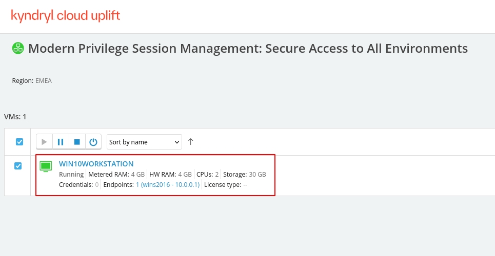

2) Click on the **Ctrl-Alt-Del** button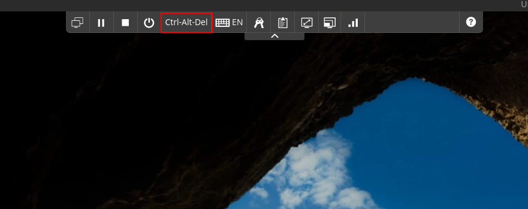

3) When prompted, type the password **Cyberark1** to sign in.**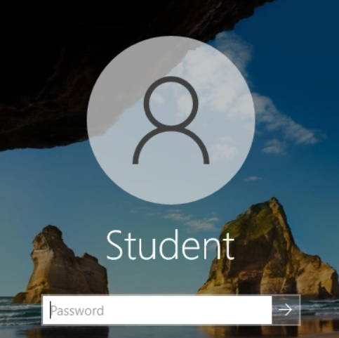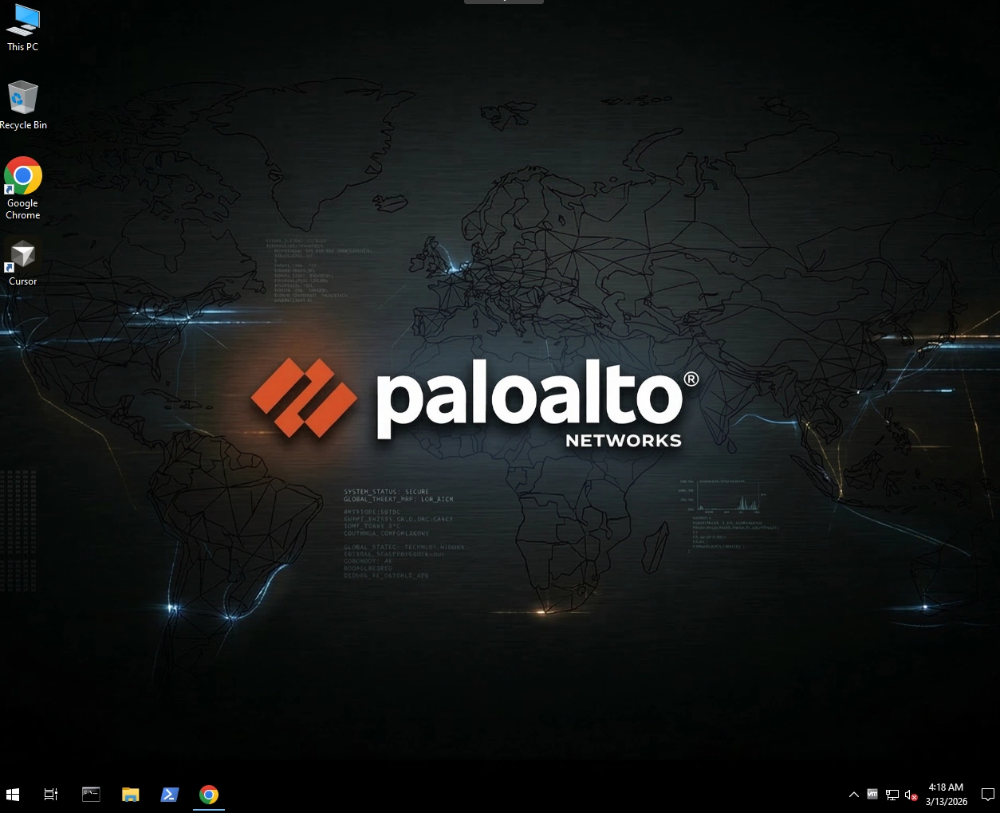**

4) Click the **Fit to Window** icon to automatically adjust the virtual machine display so it matches your screen and eliminates the need to scroll.

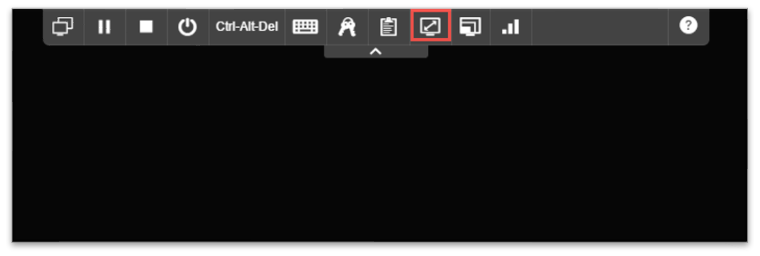

::: pagebreak :::

### 1-2 Connecting to cloud-native services

1) Launch the **Chrome** Browser from the desktop on the Kyndryl workstation.

<x-block class="alert alert-warning">
The Chrome browser already has the Cyberark Secure Web Sessions (SWS) extension installed and enabled for step recording. In this exercise, we will use Chrome to connect to the cloud console, enabling SWS to record our session.    

It's important to note that CyberArk Secure Cloud Access (SCA) provides users with native access to the cloud console with Zero-standing privileges (ZSP), regardless of the browser they use, without needing additional security controls from SWS. However, for optimal security when accessing the cloud console, it is recommended that additional security controls be applied with SWS.
</x-block>

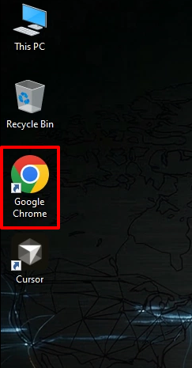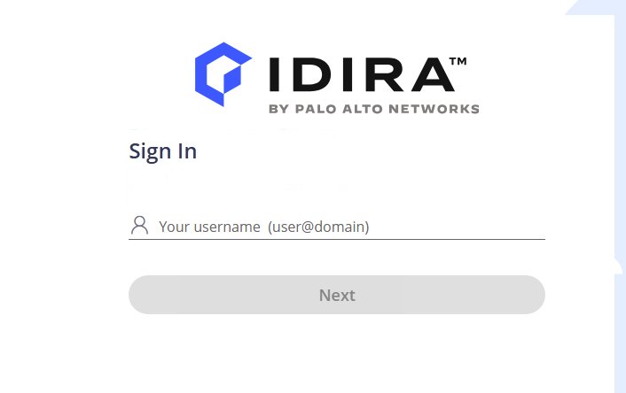

2) Sign in to the **Identity** **Portal** using the following credentials:

| Username | ^^%{metadata:CPC_Username}^^ |
| --- | --- |
| Password | ^^Cyberark1^^ |

<x-block class="alert alert-warning">
Please be aware that we decided <strong>not</strong> to require multi factor authentication only to streamline the connection process for this lab. However, multi-factor authentication (<strong>MFA</strong>) should be set in production environments to mitigate the risks of unauthorized access.
</x-block>

3) **If prompted to update your password**, set the new password to **Cyberark2**, as it will be necessary for the upcoming exercises, and then click **Next**. After this, log in again with your new password. **If no password change is requested**, keep the default one.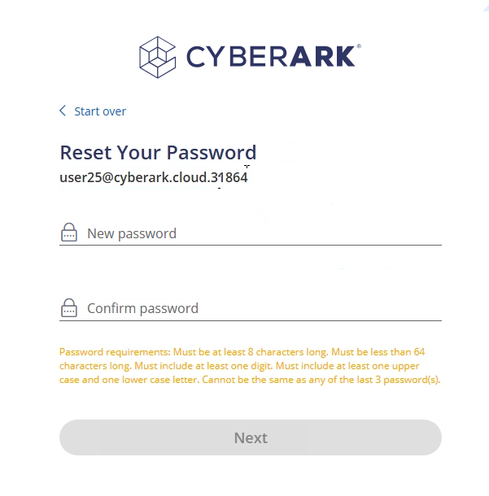

4) If you receive a prompt to sign in to the Identity Browser Extension, click **Sign in**.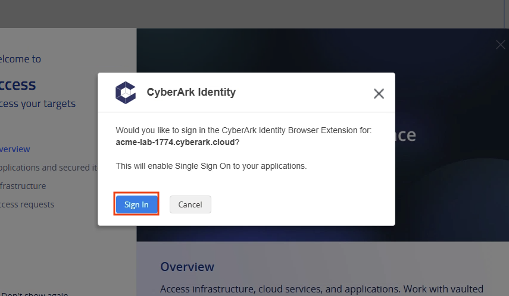

5) Verify you have successfully navigated to the **Access** space. You can close the Cora AI windows to gain a bit more space in the ui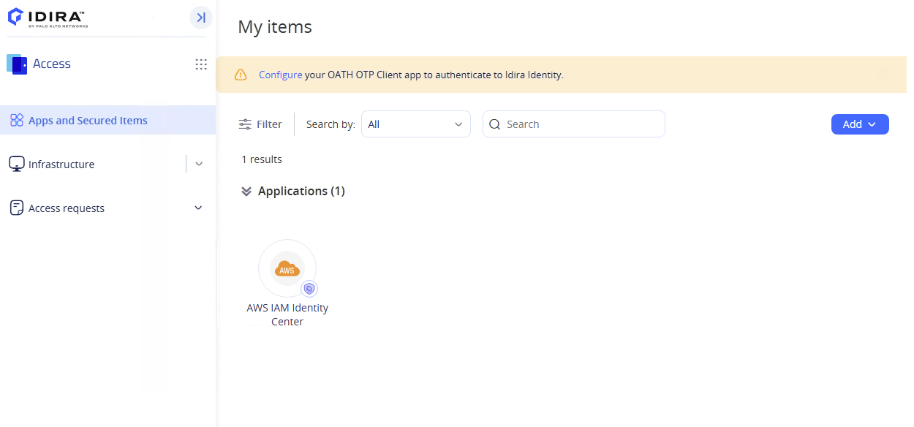

<x-block class="alert alert-warning">
The Access space enables you to manage and access your organization's cloud and infrastructure resources in a web-based environment. It integrates seamlessly with your CyberArk deployment, offering a more unified user experience. The Access space enables you to access assets secured in the CyberArk Privilege Cloud Vault via the Secure Infrastructure Access (SIA) component. The space also enables you to view and copy credentials and it provides zero standing privileges access to your organizational infrastructure.
</x-block>

6) Feel free to close the Cora AI window if you need more room on your screen.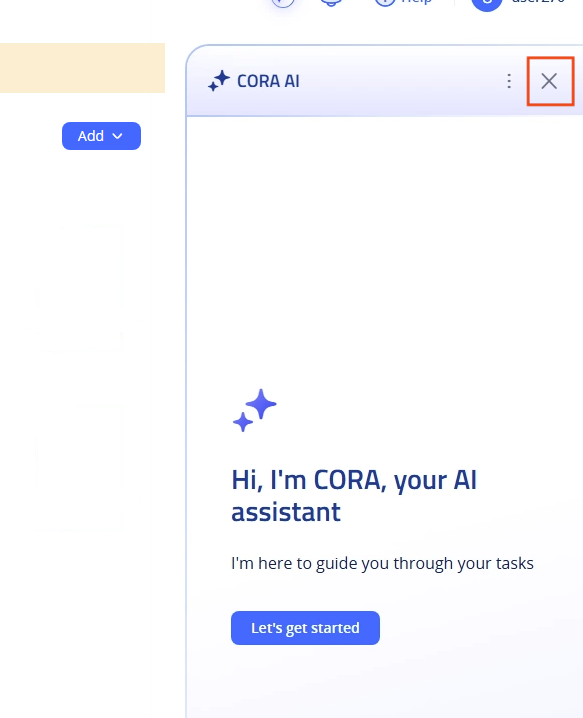

7) Click on the **AWS IAM Identity Center** tile.

8) A new tab will open in the web browser. Take a moment to read the message displayed by CyberArk, which tells you which security controls have been put in place to secure this session, in this case Step . Then click **Continue.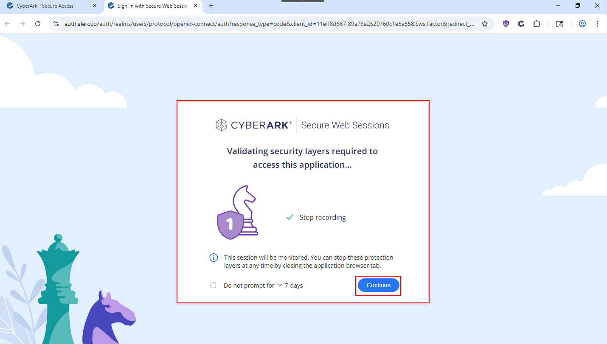**

<x-block class="alert alert-warning">
<strong>Note:</strong> If you see the following message, click on the <strong>AWS IAM Identity Center</strong> tile once more.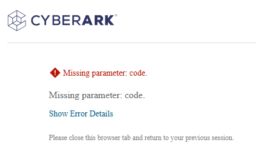
</x-block>

9) Ensure that you can see two AWS accounts, each associated with its own permission set (one permission set per account).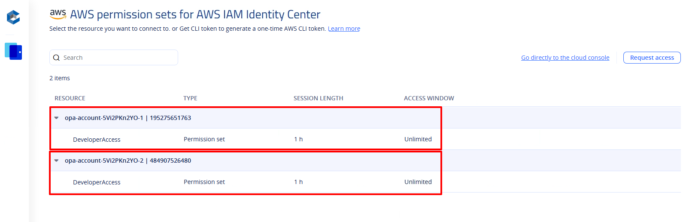

::: pagebreak :::

### 1-3 Connect directly to the Cloud Console

First, let's try connecting to the AWS cloud console directly, that is, without elevating permissions based on the policies configured in **Secure Cloud Access (SCA)**.

1) On the top right side, click **Go directly to the cloud console**.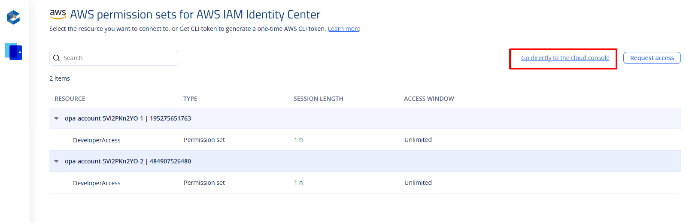

<x-block class="alert alert-danger">
The following message from AWS means that although you can log in to the AWS console, you do not have permission to access any applications or accounts. This highlights the fact your user has no standing access to resources in AWS. <strong>So even if</strong> <strong>an access key or user credentials were exposed in a public repository, an attacker might be able to connect temporarily but would not retain standing access to the</strong> <strong>account.</strong>
</x-block>

2) 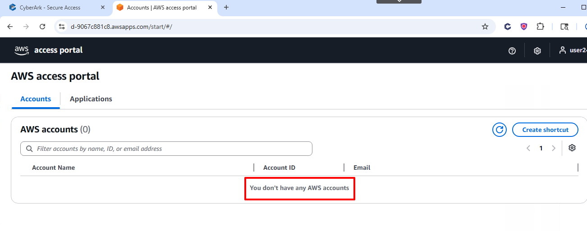Close this tab to return to the **Access space**.

::: pagebreak :::

### 1-4 Connect to the AWS console with Zero-standing Privileges (ZSP)

1) Click on the **AWS IAM Identity Center** tile again 

2) Click **Continue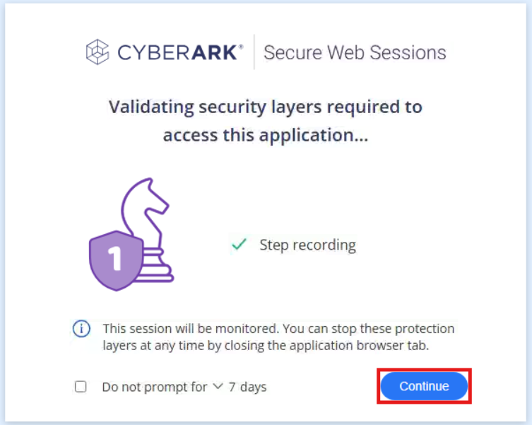**

3) Hover the mouse over the **DeveloperAccess** under the **opa-account-5Vi2PKn2YO-1** account and then click on the **Connect** button. **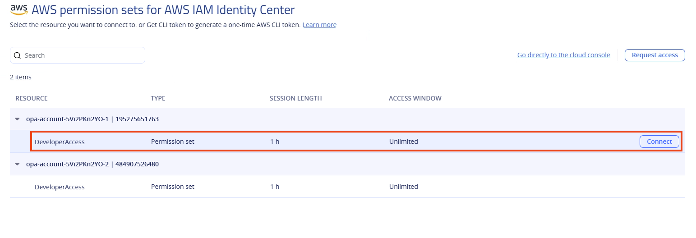**

4) Expand **opa-account-5Vi2PKn2YO-1 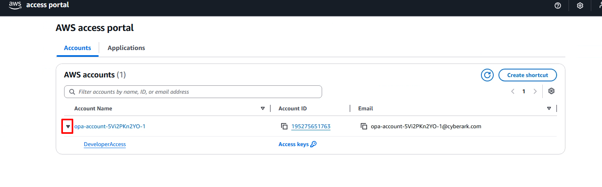**

<x-block class="alert alert-warning">
Note the difference between connecting to the cloud console using the permissions allowed by the SCA policy and connecting directly to the console previously.
</x-block>

5) Click on the **DeveloperAccess** Permission Set. **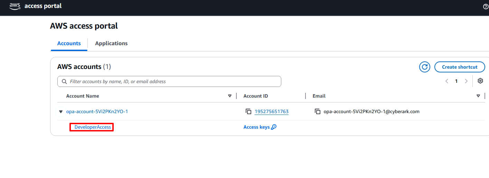**

<x-block class="alert alert-warning">
Note that here you also have the option of downloading the Access key and connecting to the account via CLI.
</x-block>

6) A new tab will open with some popups. You can either click **Next** or simply click in the background to close them before continuing. Note that the Permission set assigned to you **DeveloperAccess**, can also be seen next to your username on the top right of the window.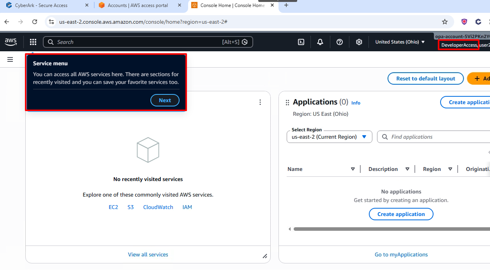

7) Verify the **AWS** datacenter is set to ***United States (N. Virginia).*** If it's not, click on it and change it to ***United States (N. Virginia)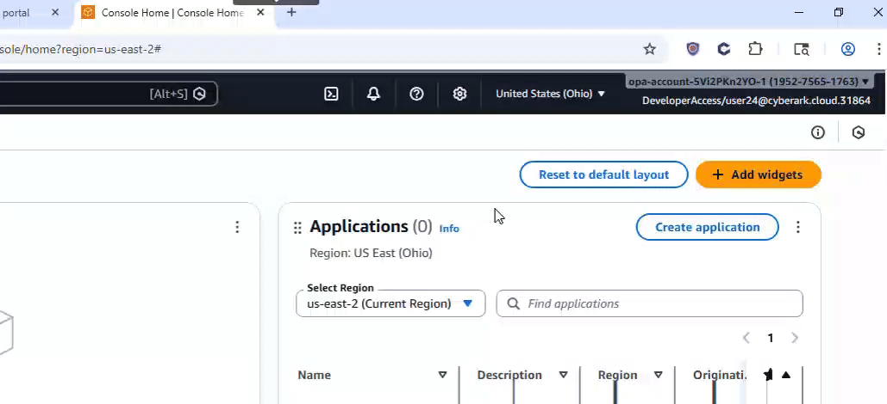***

<x-block class="alert alert-danger">
If the data center is configured to anything but for N. Virginia, no servers or databases will be available for the next steps.
</x-block>

8) 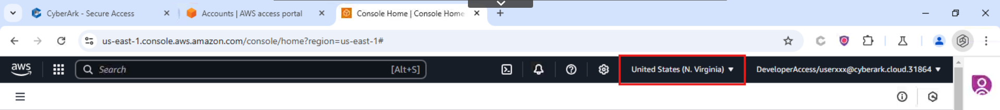In the **Recently Visited** widget, click on **EC2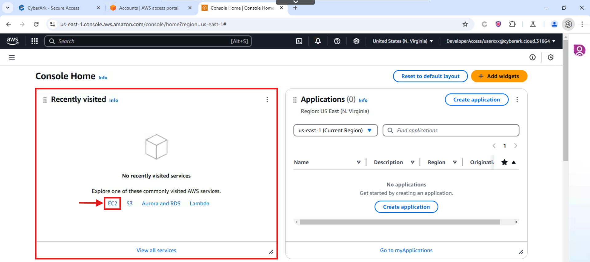**

9) In the left menu, click on **Instances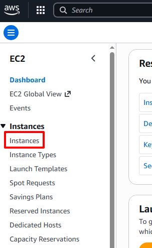**

10) **Click** on the ^^%{metadata:Target_Linux_Account}^^ target assigned for you in the access policy: 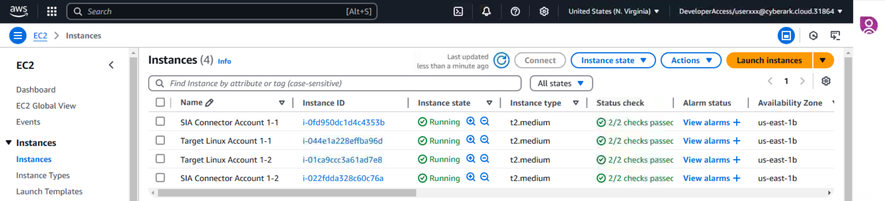

<x-block class="alert alert-warning">
<strong>Note:</strong> If you can't see the full names of the EC2 instances, you can resize the column by dragging the separator bar.
</x-block>

11) Under the **Details** tab below, locate the **Instance ID** of your assigned target and click on the **Copy** icon.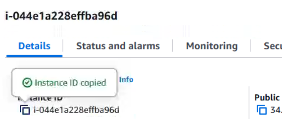

12) Move on to the next page, where we will use this Instance ID to connect to that AWS EC2 Linux instance.

::: pagebreak :::

### 1-5 Connect to a cloud-based Linux VM using ZSP

In this section, we will use the instance ID we copied from the AWS console to connect to a Linux VM hosted in the cloud, using zero-standing privileges (ZSP). CyberArk **Secure Infrastructure Access (SIA)** will manage the connection to the target system**,** ensuring isolation, monitoring, and recording of the session, which we will review in the final section of the lab.

1) Return to the **Access space** page.

2) Click **Infrastructure** and **Add target 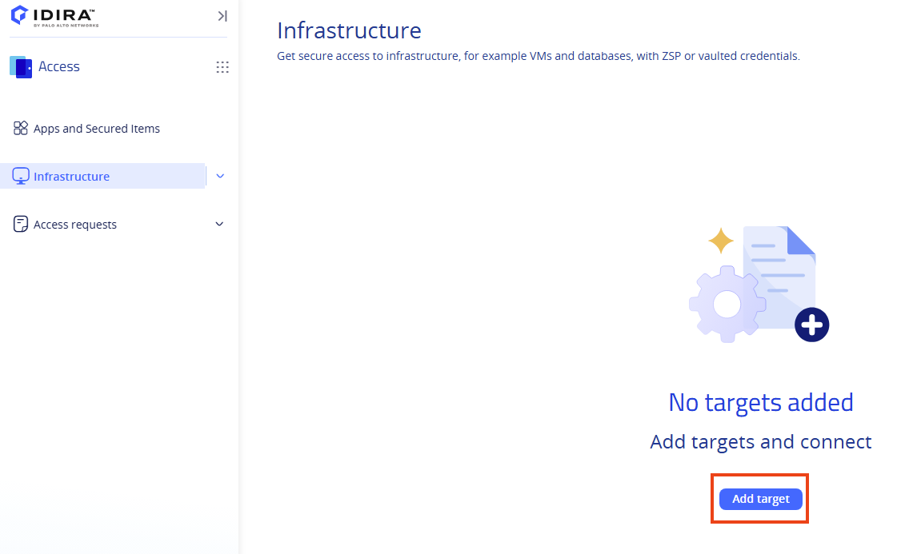**

3) Select **Linux** and click on **Continue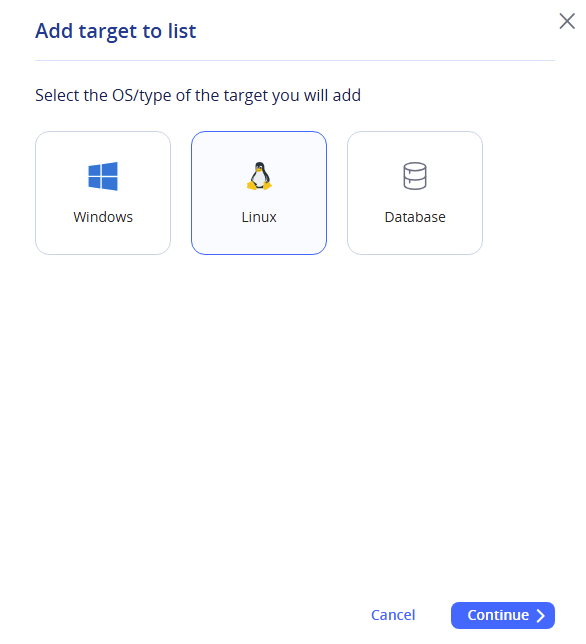**

4) Paste **your** **EC2** ***Instance ID*** in the **Address** field and click on **Add Target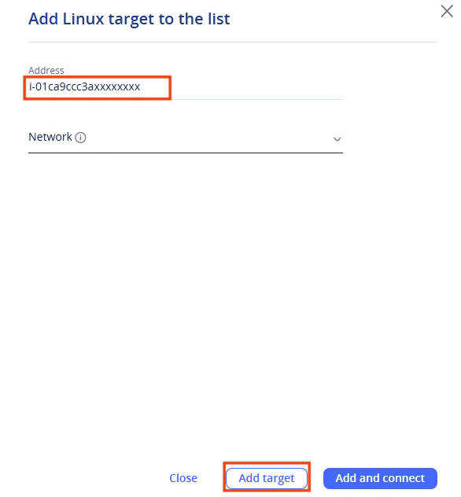**

<x-block class="alert alert-danger">
Please use the mouse right-click menu to paste the value as Ctrl+V may not work.
</x-block>

5) Ensure that a new target has been added to the list.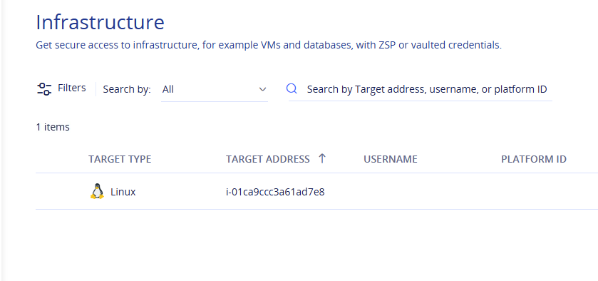

6) Hover over the new target and click on **Copy command**.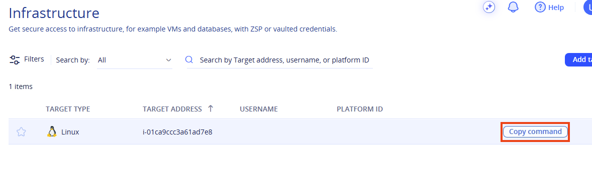

7) In the taskbar, click on the **Command Prompt** icon.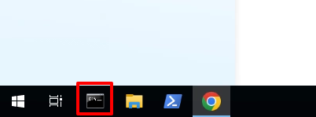

8) **Right-click** inside the prompt window to paste in the connection string and press **Enter**.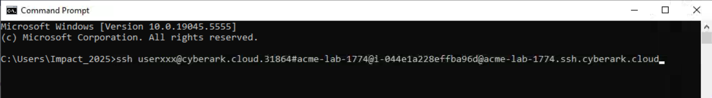

<x-block class="alert alert-warning">
Running this command sends a connection request to CyberArk SIA to establish a secure connection to a Linux VM using ZSP. SIA authorizes the end user to use attribute-based access control policies, which define both the available platform resources and the level of privileges allowed to the end user. The SIA connector then redirects the SSH session to the target, without allowing any inbound connectivity into the customer’s environment. For each authorized connection, SIA generates and signs an SSH certificate with the CA private key which is used to authenticate the end user to the target machine as an existing local user of the target machine. This SSH certificate is invalidated for further use within minutes so that no one else can use it. Every new authorized connection request, even by the same user to the same target, generates a new SSH certificate.
</x-block>

9) Type **Yes** when asked to continue connecting.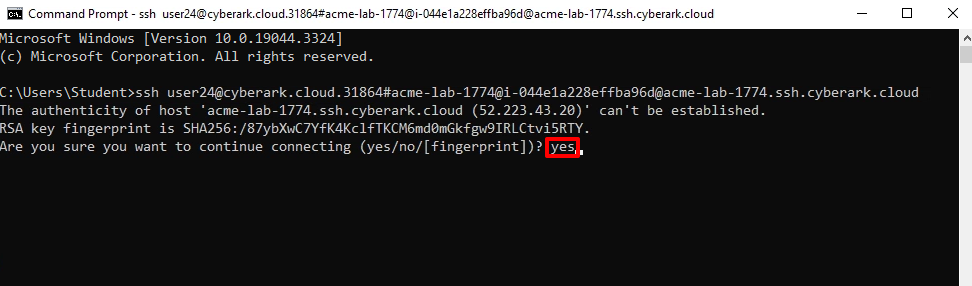

10) Type in **^^Cyberark2^^** when prompted for the password. *(**Note** that if you were not asked to reset your password at the start of the lab, use the default one Cyberark1)* Please note that if MFA was enabled, you would complete the MFA process at this point. 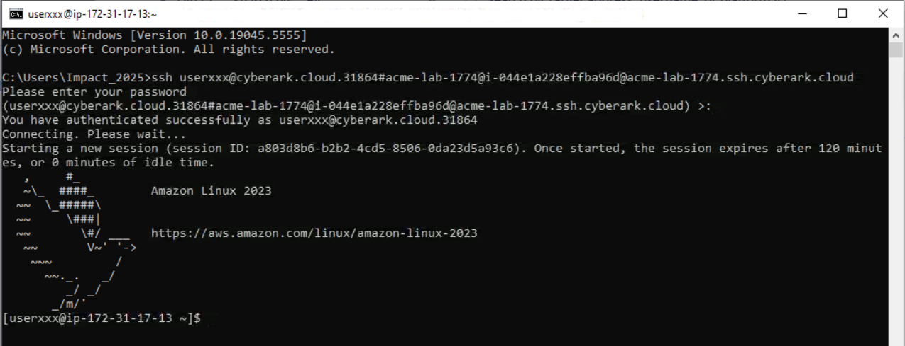

11) Please continue executing the following commands to generate some audit content, which we will use later.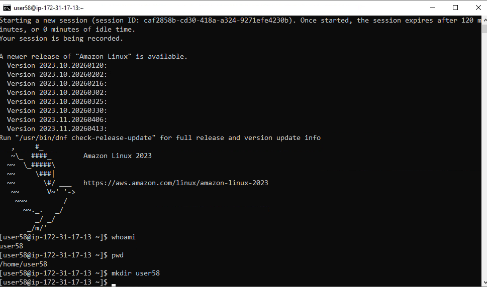

<x-block class="alert alert-warning">
^^whoami^^   ^^pwd^^   ^^mkdir %{metadata:User}^^
</x-block>

12) Execute the command ^^**passwd**^^. This command allows you to change your own password. When prompted for the current password, simply press **Enter** without inputting anything. Notice your session will be terminated as expected. The Threat Detection and Response (TDR) system flags the passwd command pattern as suspicious and is configured to automatically end sessions when that activity is detected. A screenshot from the TDR rule created for the lab is also included below **for reference**.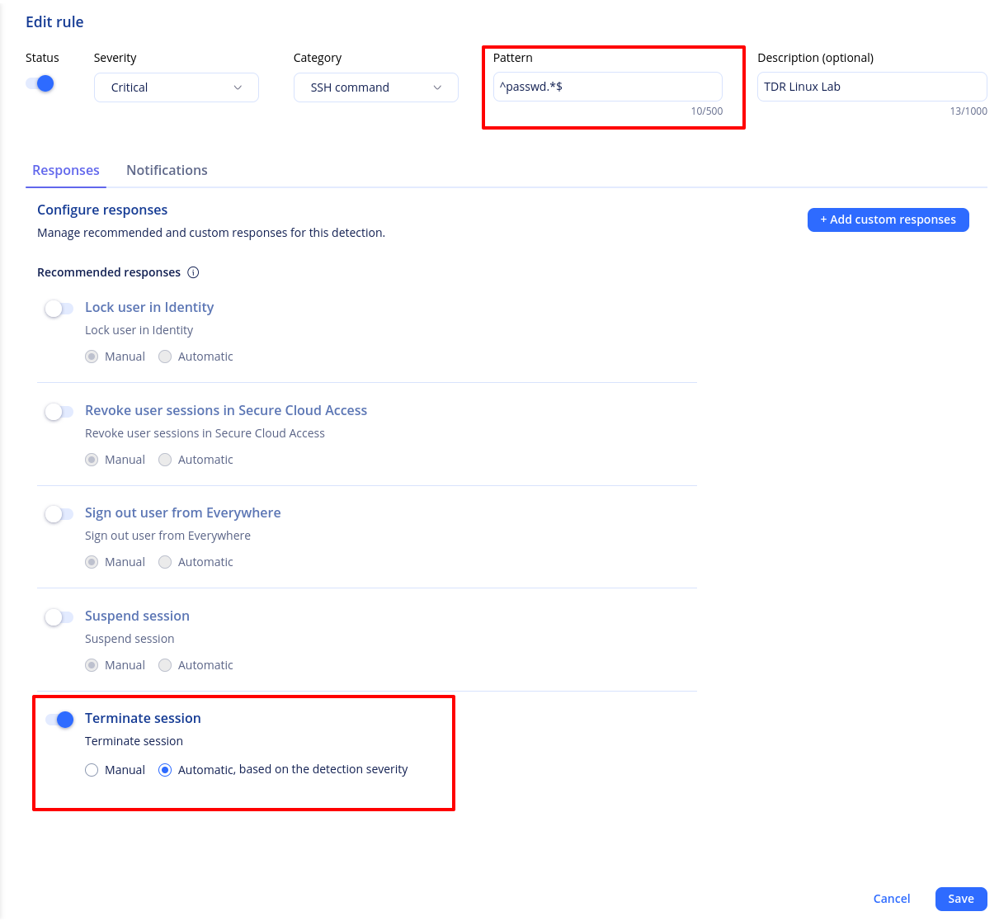

::: pagebreak :::

### 1-6 Attempt to connect to a Linux VM without a Policy

In this exercise, we will attempt to connect to a Linux VM for which the access policy does **not** permit user access.

1) Return to the **AWS EC2 Instances** tab and then select the **other** Target Linux Account. If you previously connected to Target Linux Account 1-1, select Target Linux Account 1-2. Conversely, if you connected to Target Linux Account 1-2 earlier, select Target Linux Account 1-1.

2) Copy the **Instance ID** of the other Target Linux Account.

3) Return to the **Access space**, click **Infrastructure** | **Add Target**.

4) Select **Linux,** click on **Continue** and paste the *Instance ID* in the **Address** field.

5) Click **Add target**.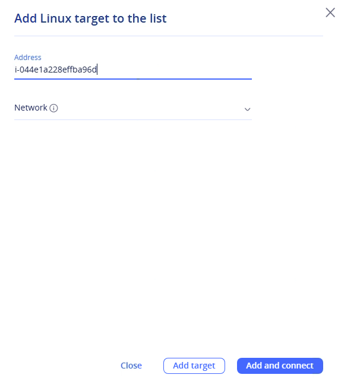

6) On the new onboarded target, click **Copy command**.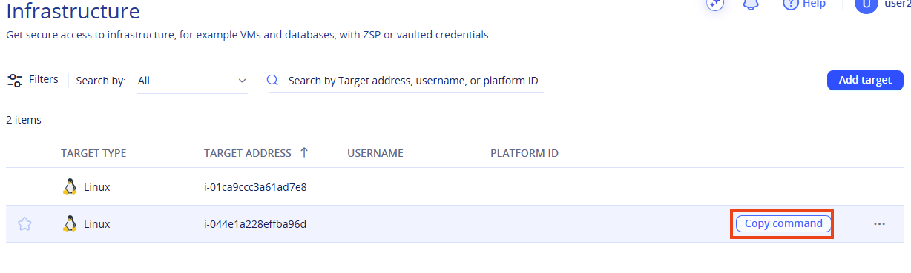

7) Return to the **Command Prompt** we opened earlier, or open a new one if you closed the previous one, and paste the connection string by right-clicking.

8) Enter **Cyberark2** as the password and press **Enter**. *(Note that if you were not asked to reset your password at the start of the lab, use the default one Cyberark1)*

9) Even though your credentials are correct, access to the Linux virtual machine is denied because there is no policy that grants the user permission to access this system: 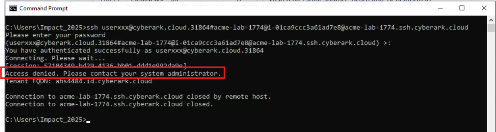

10) Close the Command Prompt and proceed to the next exercise.

::: pagebreak :::

### 1-7 Connecting to a Database using ZSP

In this exercise, we will connect to a PostgreSQL database using zero-standing privileges (ZSP).

1) In the AWS **Home | EC2 | us-east-1** tab type in ^^rds^^ in the search bar at the top and select **Aurora and RDS**.**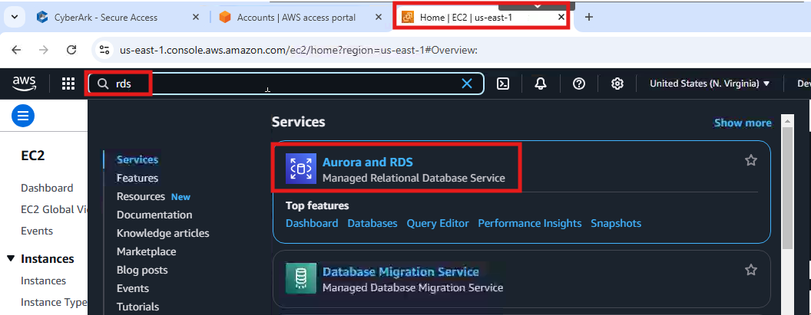**

2) On the left side, click on **Databases**.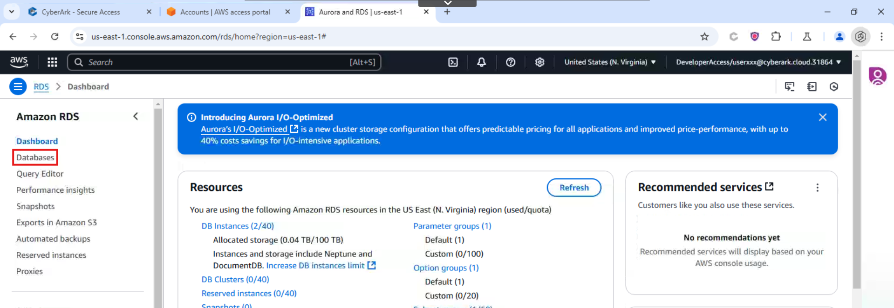

3) You should see two databases on this page. If not, make sure the data center is set to **United States (N. Virginia)**.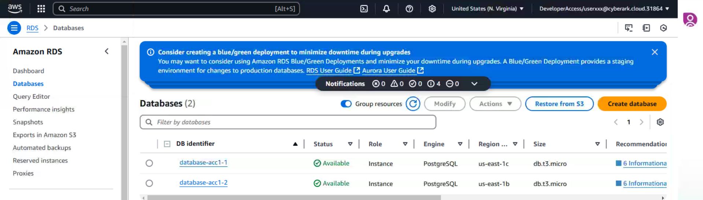

4) Click on the **DB Identifier** assigned to you in the access policy: ^^%{metadata:Target_Database_Account}^^

5) Under the **Connectivity &amp; Security** tab, select **Endpoints** 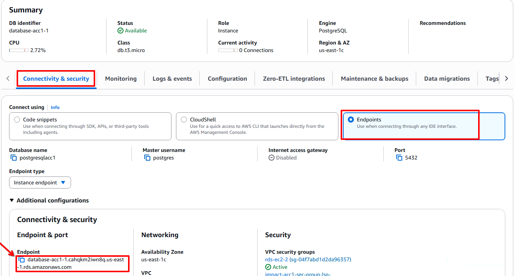

6) Click the **Copy** button located to the left of the **Endpoint** ID.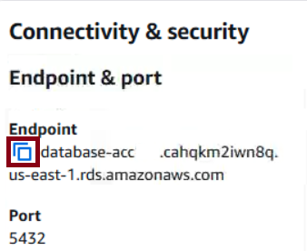

7) Return to the **Access** space.

8) Click **Infrastructure**, then **Add Target**.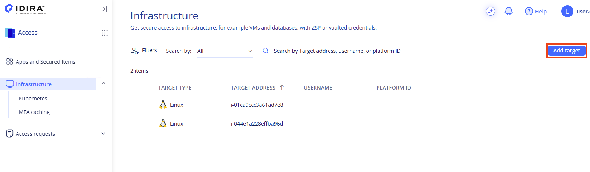

9) Select **Database** and click on **Continue**.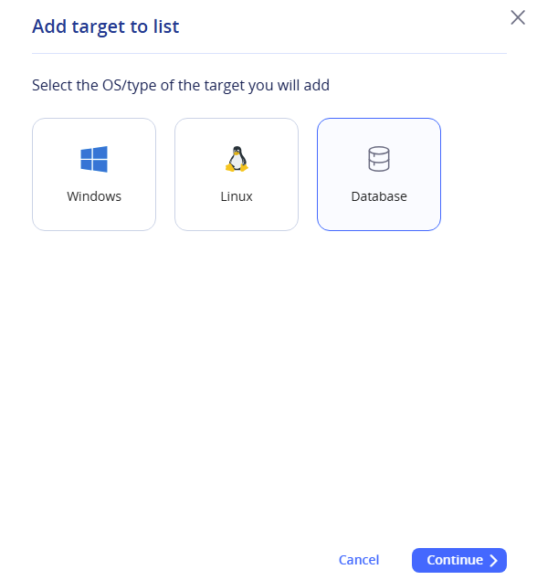

10) Select **PostgreSQL** as the Database type.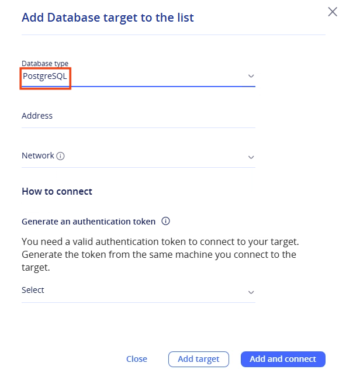

11) **Paste** the database endpoint address copied in the previous step by using the mouse right-click menu.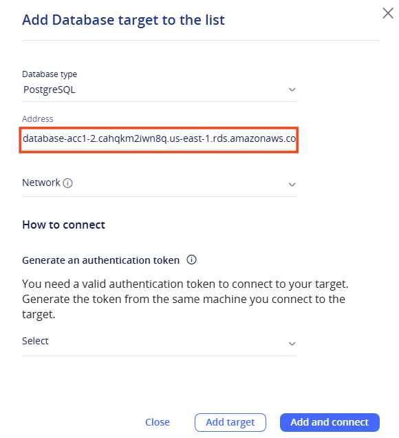

12) Scroll down to the **How to connect** section and select **Generate a new password token** as the authentication token. Then click on **Add Target**

<x-block class="alert alert-warning">
The MFA caching feature enables connection to multiple target databases while performing the MFA authentication flow only once (in a configurable period of time).
</x-block>

13) Verify you can see a new target in the list. Hover over it with the mouse, then click **Open connection guide**.

14) Click on the **Get connection details**

15) Expand the **Connect using a command line tool** section and click the **Copy** button to copy the psql connection string.

16) Open a **Command Prompt** window from the taskbar, paste the string via a right-click and press **Enter**.

<x-block class="alert alert-warning">
Running this command sends a connection request to CyberArk SIA to establish a secure connection to a PostgreSQL database using ZSP. SIA authorizes the end user to use attribute-based access control policies, which define both the available platform resources and the level of privileges allowed to the end user. For each authorized connection, SIA creates a local database user, joins this user to database roles that were defined in the chosen policy, and deletes it when it is no longer needed. This is done using a pre-supplied local strong user with the appropriate permissions.
</x-block>

17) When prompted for a password, return to the **Access space**, and copy the **Authentication Token**.

18) Paste the token in the **Command Prompt** via a right-click and press **Enter**. The result should indicate a successful connection, as shown below.

19) Confirm the ID of the generated **ephemeral** user using the following command. This user is assigned the cook role, which provides access to the food database.

<x-block class="alert alert-warning">
^^select current_user;^^
</x-block>

20) Type in the command below to list the available databases. The **food** database should appear at the list.

<x-block class="alert alert-warning">
^^\list^^
</x-block>

21) Connect to the database via the following command

<x-block class="alert alert-warning">
^^\c food^^
</x-block>

22) Once connected, display the tables using the following command. You should see a table named **favorite_food.**

<x-block class="alert alert-warning">
^^\dt^^
</x-block>

23) Next, enter your favorite food in the table using the following command.

<x-block class="alert alert-danger">
Please do not enter the command as it is. Replace only the two parameters within the apostrophe as follows: <em><strong>YourFirstName</strong></em> represents your first name, for example <em>Chris</em> and <strong>FavoriteFood</strong>  represents your favorite food, for example <em>Pizza</em>. Note that if you have difficulties with the command you can skip it and move to the next step.
</x-block>

<x-block class="alert alert-warning">
^^INSERT INTO favorite_food VALUES (%{metadata:UserID},'YourFirstName','FavoriteFood');^^
</x-block>

24) Check the table entries by running the following command. You should see your user ID along with your first name and favorite food if you typed the command successfully:

<x-block class="alert alert-warning">
^^SELECT * FROM favorite_food;^^
</x-block>

25) With that done, we can close our connection to the database with the following command:

<x-block class="alert alert-warning">
^^\q^^
</x-block>

26) You can close the Command Prompt.

::: pagebreak :::
