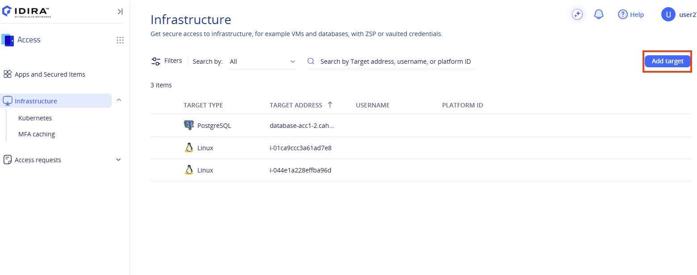
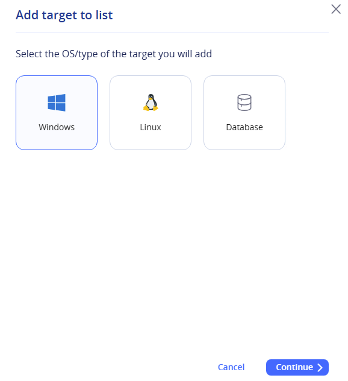
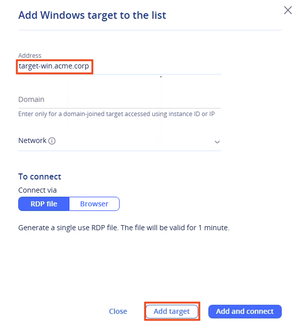
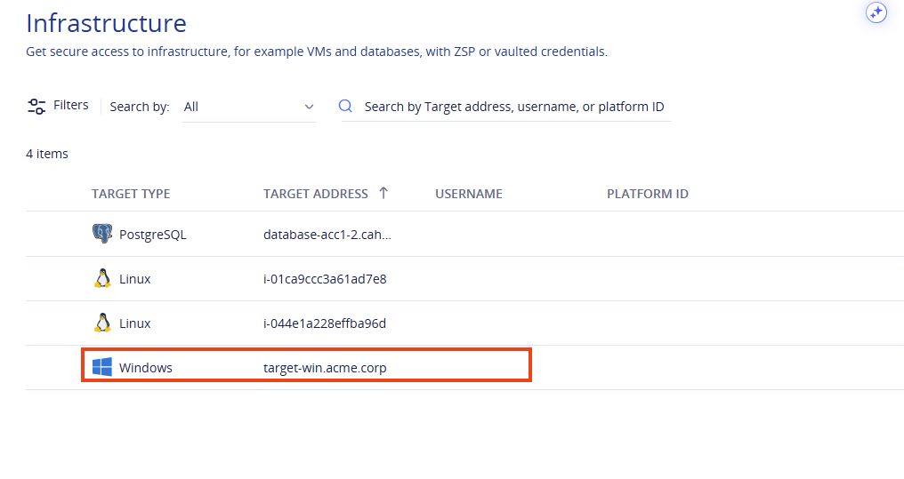
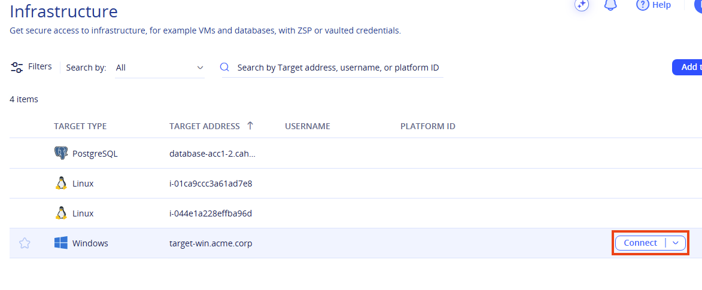
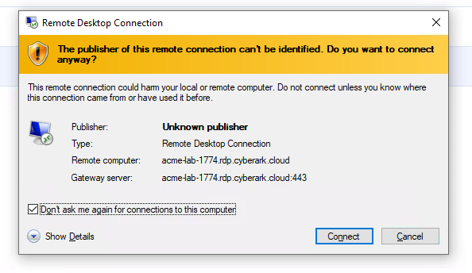
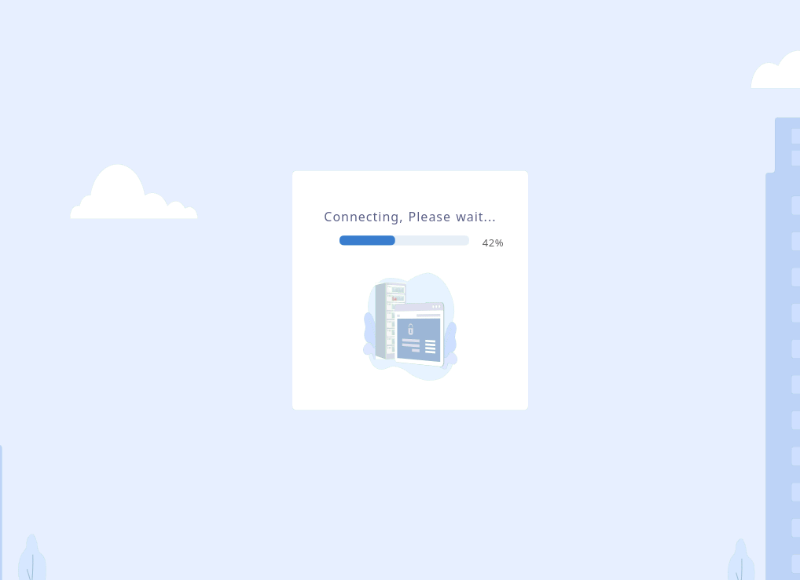
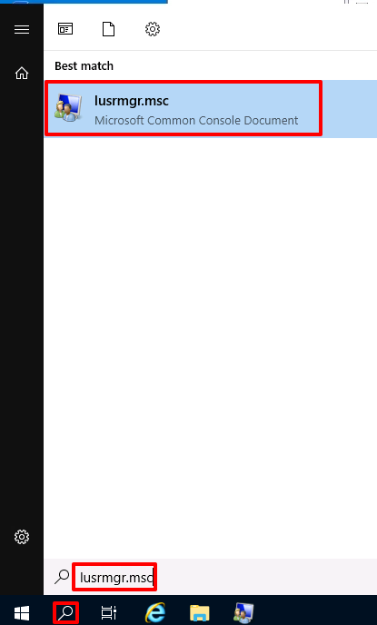
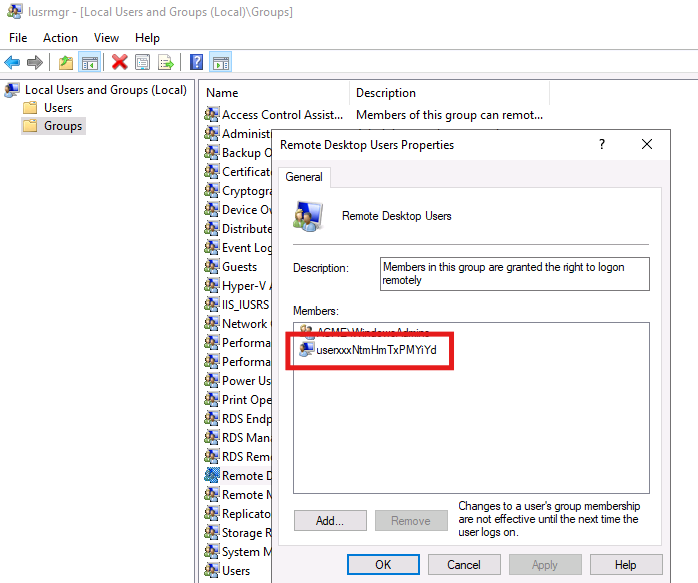

## Section 2: Secure Access to Long-lived Windows Systems using Zero-standing Privileges (ZSP)

In this section, you will connect to a Windows target using ZSP.

::: pagebreak :::

### 2-1 Connect to a Windows VM using ZSP

In this exercise, we will connect to a Windows VM using zero-standing privileges.

SIA for zero standing privileges access works differently for each target type. For a Windows target, SIA creates an ephemeral user and adds it to a local group on the target. Then, the SIA connector redirects the RDP session to the target, without allowing any inbound connectivity into the customer’s environment. This method enables the user to work on the target with a domain or local user that has the appropriate permissions.

The ACME administrator already created a policy to grant you access via **ZSP**.

1) Return to the **Access** space, navigate to **Infrastructure** and click on **Add target**.

2) Select **Windows** and click on **Continue**.

3) Enter the following address: ^^%{metadata:PPA_Address}^^ and click on **Add Target**

4) Note the target has been added, but the username field is empty.

5) Hover over the target and then click on the **Connect** button.

6) Click on the RDP file to launch the session. If prompted about the publisher, select "Don't ask me again for connections to this computer" and click **Connect**.

7) On the target machine, click the Windows search icon in the taskbar, type **^^**lusrmgr.msc**^^** and press **Enter**.

8) Under the **Local Users and Groups** -&gt; **Groups** open the **Remote Desktop Users** group**.**

9) Verify you can see your ephemeral user ID identified by the user's name followed by a random string.

<x-block class="alert alert-warning">
When you connect to a Windows VM using ZSP, CyberArk creates an ephemeral account in the target system and adds it to a local group, in this case, Remote Desktop Users. This method ensures no permissions are associated with the credentials you used to access the target system until they are needed, and they are removed again at the end of the session. This approach minimizes the security risks associated with standing access.
</x-block>

10) Close the lusrmgr windows and Sign out of the RDP session. 

::: pagebreak :::
