## Section 3: Secure Standing Access to Long-lived Windows Systems

In this section, you will perform the following exercises:

- Onboard a personal privileged account to the Vault.
- Connect to a Windows target from the Privilege Cloud portal.
- Connect to a Windows target from the new Access space.
- Connect to a Windows target using Vaulted credentials with just-in-time elevation.

::: pagebreak :::

### 3-1 Onboard a Personal Privileged Account

In this exercise, you will add your personal privileged account (PPA) to the Vault using **Privilege Cloud**. A PPA is an account created for individual use and stored in a private, dedicated Safe. A personal account is quicker to create and more straightforward to manage than a regular account. This capability frees Privilege Cloud administrators from performing preliminary tasks for newly provisioned end users creating new accounts.

We will then use the PPA account to connect to a long-lived Windows target via **CyberArk Secure Infrastructure Access (SIA)**.

1) Click the **Waffle** button and then select **Privilege Cloud.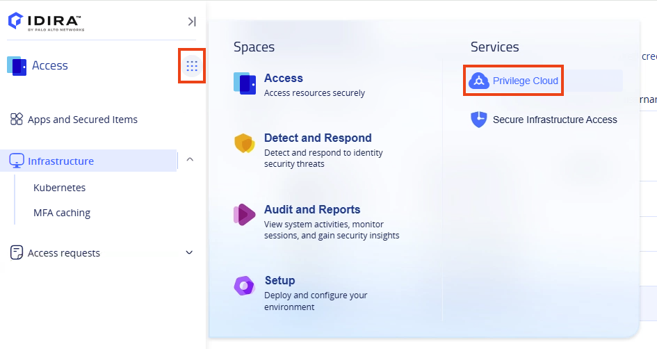**

2) In the **Accounts view** page, select **Add personal privileged account**.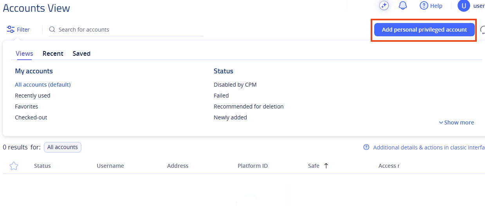

3) Set the account properties as detailed in the table below and click on **Add**.

| Address | ^^acme.corp^^ |
| --- | --- |
| Username | ^^%{metadata:PPA_Username}^^ |
| Password | ^^Cyberark1^^ |

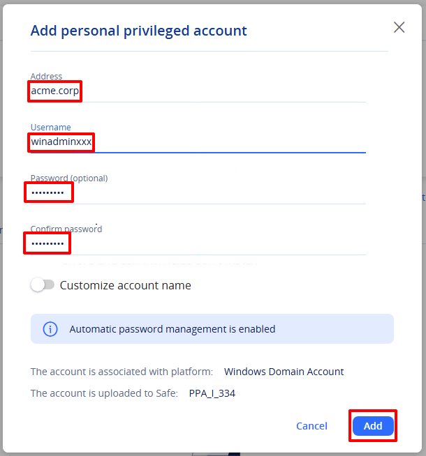

4) Ensure that your account is listed on the **Accounts View** page.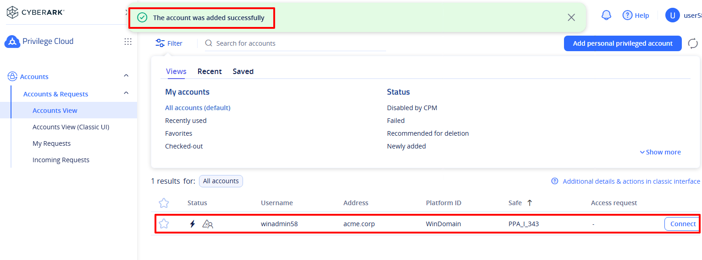

info>A personal privileged account is scheduled for automatic Verification when added to the Vault. After the account is successfully verified, additional actions such as **Change** and **Reconcile** password will also be available. This ensures that only the end user who owns the account and, therefore, knows the password can successfully onboard and manage the account.

The **Verify** task can take a few minutes, so for the sake of efficiency, we will not wait for the Verify action to complete or initiate a **Change** task, which would be required in the real world. Instead, we will proceed right away to the next section and connect with the account.

::: pagebreak :::

### 3-2 Connect to a Windows VM from the Privilege Cloud portal

First, we will connect to a Windows VM using the account we just onboarded. We will initiate the connection from the **Privilege Cloud** portal, but **CyberArk Secure Infrastructure Access (****SIA)** will manage the session. When a user makes a request to access a target using vaulted credentials, SIA will provide access based on the existing access control policies with the user’s permissions in Safes in CyberArk PAM, where the vaulted credential is stored. Then, the SIA connector redirects the session to the target, without allowing any inbound connectivity into the customer’s environment.

Note that the option of launching a secure session from the Privilege Cloud portal using **SIA** is available only for Windows targets, and only when using Vaulted credentials. In later sections, we will see how to use **SIA** when connecting to Windows and other infrastructure targets using the **Access space**.

info>Please note the admin needs to perform a few steps to enable the option of launching a connection via **SIA** from the **Privilege Cloud** portal**.** These steps are explained [here](https://docs.cyberark.com/privilege-cloud-shared-services/latest/en/content/privilege%20cloud/privcloud-dpa-configure-pvwa-access.htm#ConfigureSIAconnectioninPrivilegeCloudPSMexists).

1) While still in **Privilege Cloud**, click the **Connect** button for ^^%{metadata:PPA_Username}^^.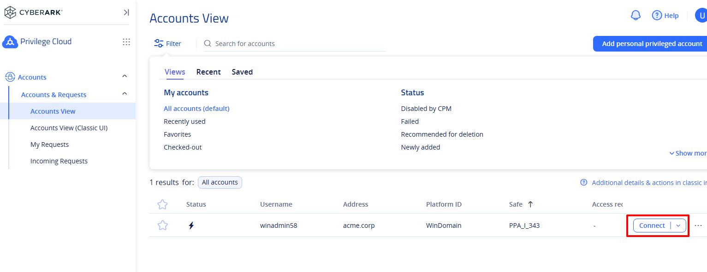

2) Fill in the **Remote Machine** field with the target address: ^^%{metadata:PPA_Address}^^ 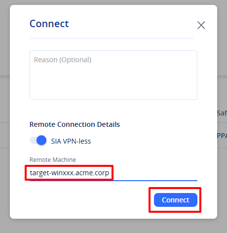

<x-block class="alert alert-warning">
Note that the <strong>SIA VPN-less slider</strong> allows users to determine whether to use <strong>SIA</strong> or <strong>PSM</strong>. In this lab PSM has not been deployed.
</x-block>

3) Click **Connect** and open the RDP file to launch a secure native session to the Windows target.

<x-block class="alert alert-danger">
For security reasons, the <strong>RDP</strong> file downloaded contains a one-time secure token which expires after 60 seconds.
</x-block>

4) Verify you where connected and then sign out from the **RDP** session.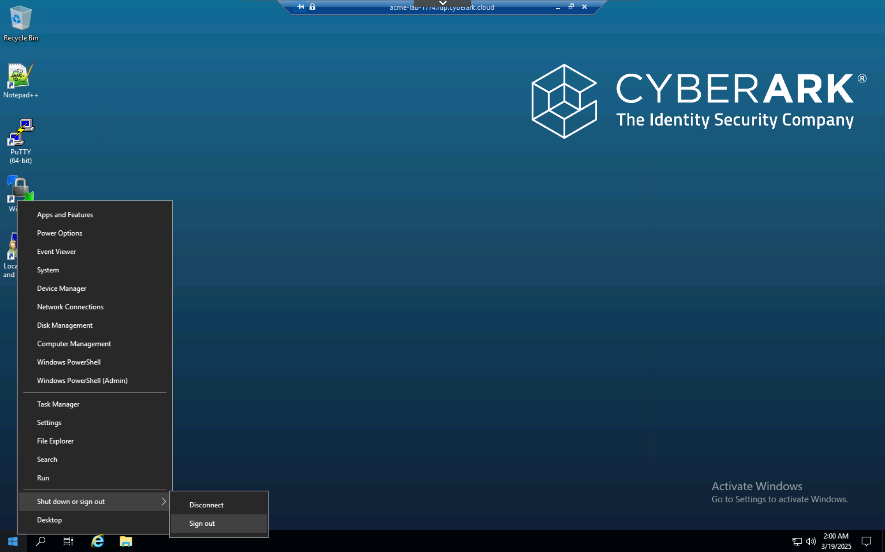

::: pagebreak :::

### 3-3 Connect to a Windows VM from the Access space

1) Click the **Waffle** button and then select **Access**.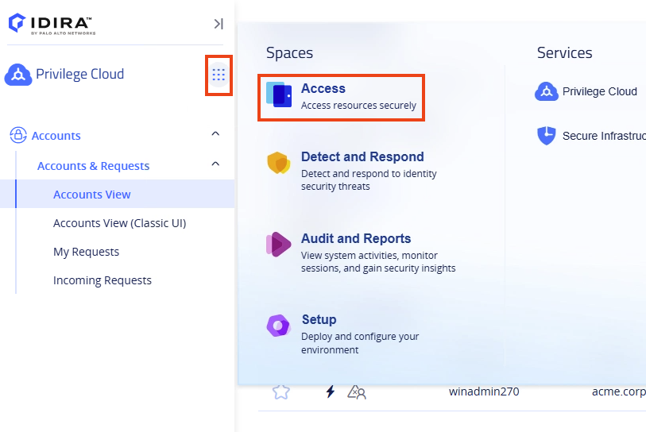

2) Click **Infrastructure and n**otice the privileged account we on boarded earlier is already listed. If the account is not listed, please **refresh** the page.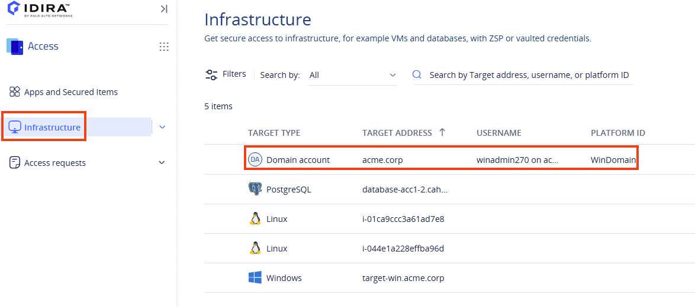

3) Hover over the account and click the **Add Windows target** button to define the target.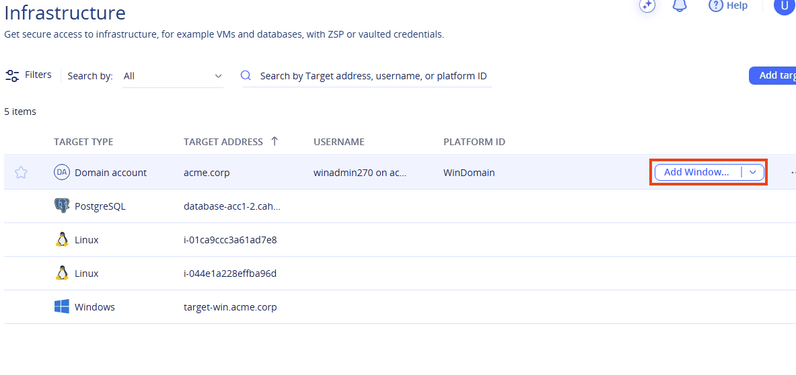

4) Fill in the target address: ^^%{metadata:PPA_Address}^^

5) Verify the **Connect using Just-in-time elevation** is unchecked, then click **Add and Connect**.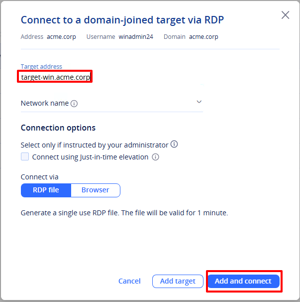

6) Click on the **RDP file** to open the session. Once connected, double-click on the **Local Users and Groups** icon, then navigate to **Groups** and **Remote Desktop Users**.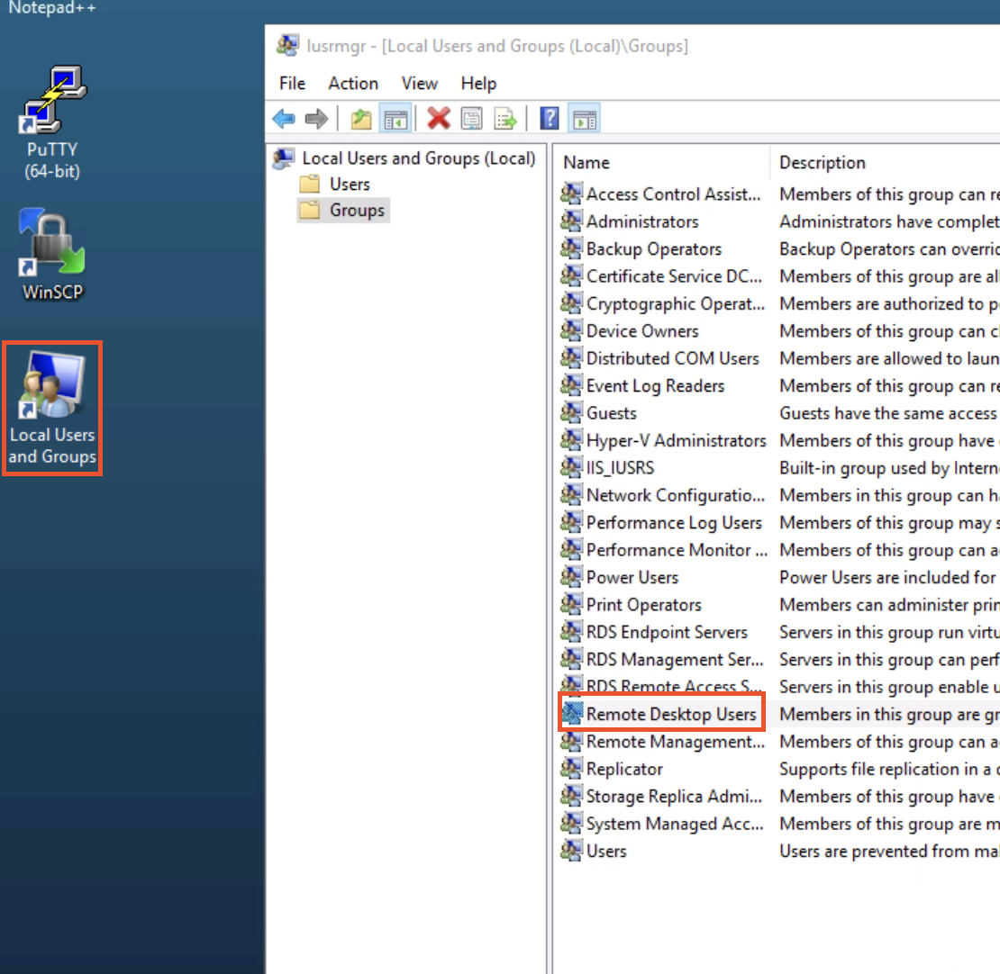

7) Verify you can see the group **ACME\WindowsAdmins**. 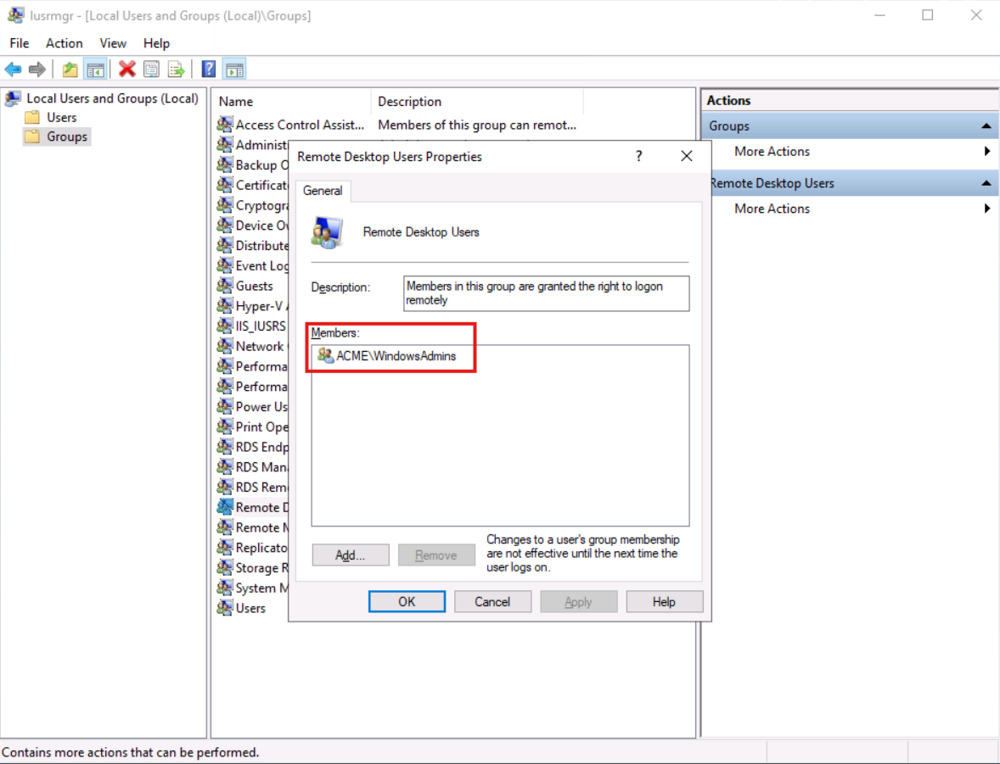

<x-block class="alert alert-warning">
The domain account we used to connect to the target is a member of the <strong>WindowsAdmins</strong> group. This means our privileged account has standing access to the target system. Although we mitigate the risk of standing access by managing the credentials in the CyberArk PAM Vault, there is always a risk associated with standing access. As seen in previous sections, this risk can be reduced by removing standing access and implementing a zero-standing privileges (ZSP) model.
</x-block>

8) Close the windows and Sign out of the session.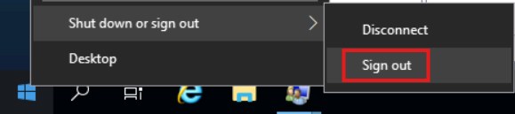

::: pagebreak :::

### 3-4 Connect to Windows using Vaulted credentials with Just-in-time Elevation

When using this feature, users connect to targets with credentials that are managed in the Privilege Cloud Vault with little or no associated permissions. Upon connecting to a target system, users receive only a selected range of relevant permissions defined in the appropriate policy. At the end of the user’s session, these permissions are removed.

With this workflow, users can access Windows targets on a just-in-time basis, with time-bound sessions. Security teams can meanwhile maintain the existing user profiles of an account, including key credential management and rotation policies

1) Under the **Access** space, hover over the **acme.corp** account and click the **Add Windows target** button again. 

2) Fill in the **Target address**: ^^%{metadata:PPA_Address}^^

3) Verify the **Connect using just-in-time** **elevation** box is checked and click on **Add and connect**.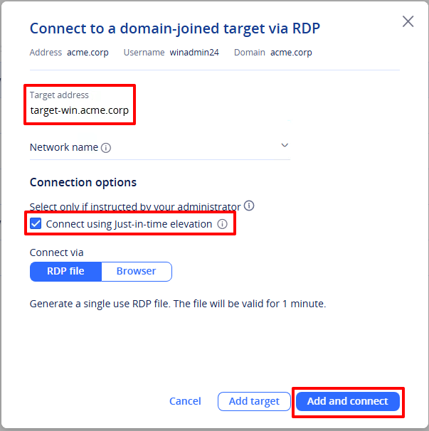

4) Open the RDP file to launch the session and once connected, double-click on the **Local Users and Groups** icon, then navigate to **Groups** and **Remote Desktop Users** and Verify you can see the member **ACME\%{metadata:PPA_Username}** in the list.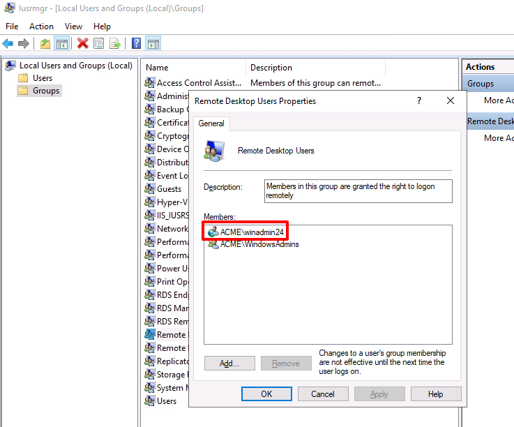

<x-block class="alert alert-warning">
In this scenario, the Vaulted credentials used to access the target system do not have standing privileges. Instead, the target account is added to the local group only when needed, providing us with the needed permissions just in time. The target account will be removed from the local group when we disconnect.
</x-block>

5) Close the windows and sign out of the RDP session. 

::: pagebreak :::
