## Section 4: Request Temporary Access to a Cloud Console

In this section, you will request for access to an AWS account within the AWS organization that you do not have access to.

There may be instances where your current permissions are insufficient to accomplish a specific task. If you need to access a cloud console that doesn't appear in your Access space or if you need additional permissions to perform a task in a cloud console that does appear in your Access space, you can make a one-time request for temporary access.

::: pagebreak :::

### 4-1 Request temporary access to an AWS account

In this section, you will request access to the AWS account **opa-account-xxxx-3** that you currently do not have access to.

1) Navigate to the **Apps and Secured Items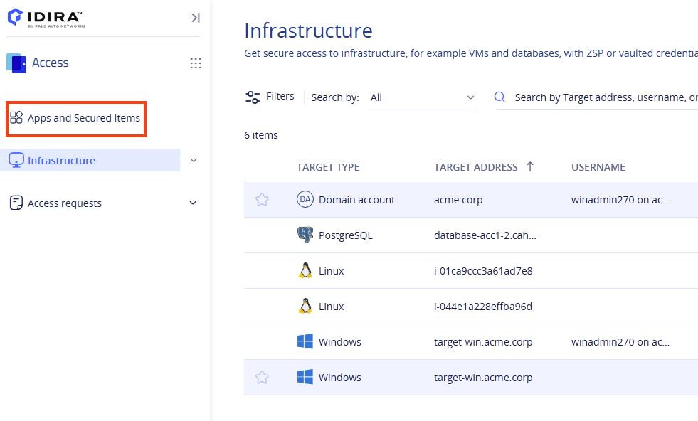**

2) Click on the **AWS IAM Identity Center** tile. 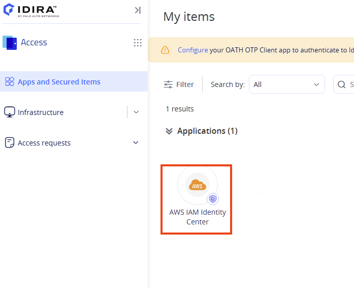

3) Click **Continue**.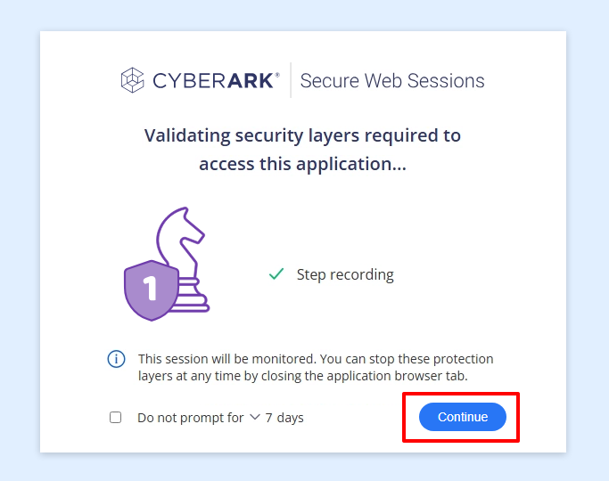

<x-block class="alert alert-warning">
<strong>Note:</strong> If an <strong>Error 401</strong> message appears it might be because the session has expired, close and reopen Chrome, sign in again, and retry opening the <strong>AWS IAM Identity Center</strong> tile.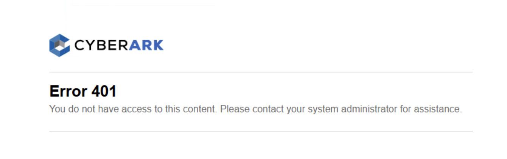
</x-block>

4) Click on **Request access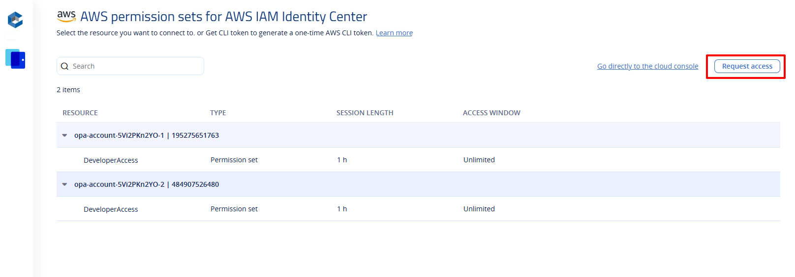**

5) Specify a **reason** of your preference for your request, let the **priority** to Medium, enter **^^**opa-account-5Vi2PKn2YO-3**^^** under the account name and select the account. Type ^^**ReadOnlyAccess**^^ for the requested permission set and select the permission set.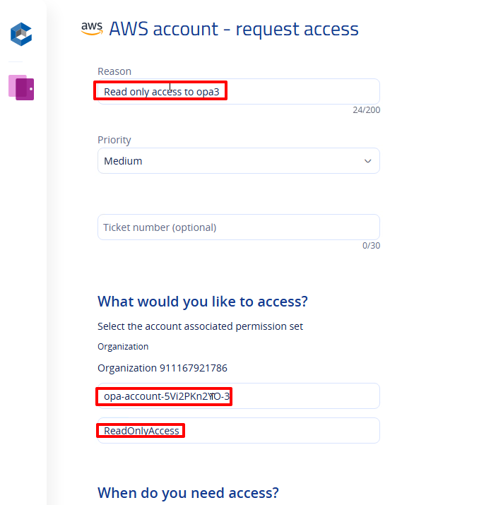

6) The time zone is set according to the time zone of your workstation. Specify the **Date** as the current date along with the start and end times to ensure a session length of at least 2 hours. Set the time according to your Lab Virtual Machine. When ready click on **Send request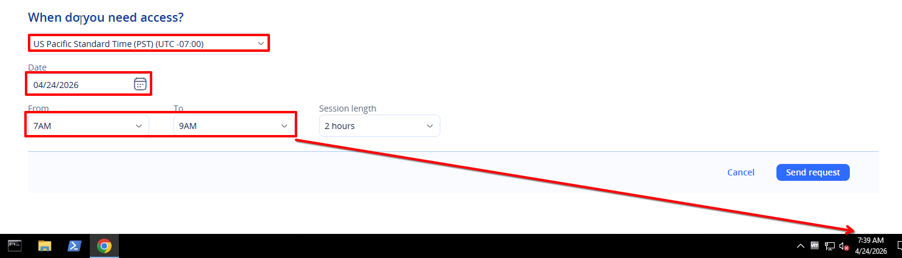**

7) Your request will be sent for approval. A screenshot from the approver's point of view is also included below **for** **reference**. In our case, a script runs every 30 seconds to check for new requests and automatically approves any that are pending.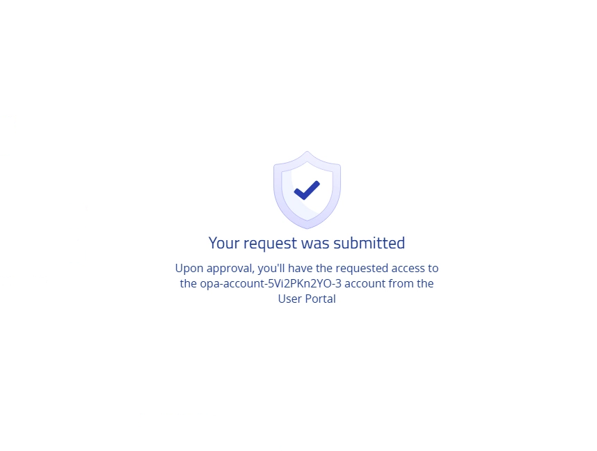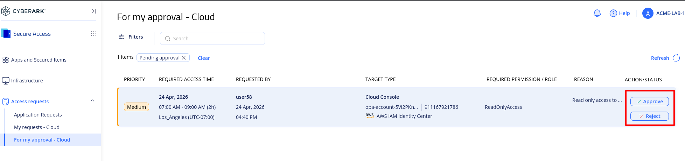

8) To check the status of your request, navigate to the **Access** space and navigate to **Access Requests**, then select **My Requests - Cloud**.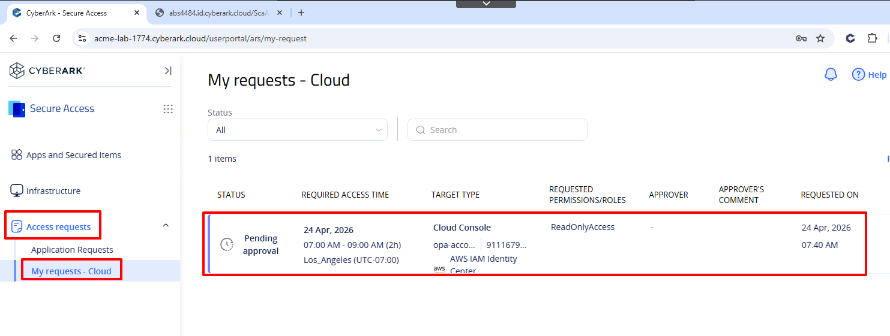

9) Once approved, the status will change from ***Pending Approval*** to ***Pending Fulfillment*** and finally to ***Fulfilled***. You can click the refresh button to view the current status.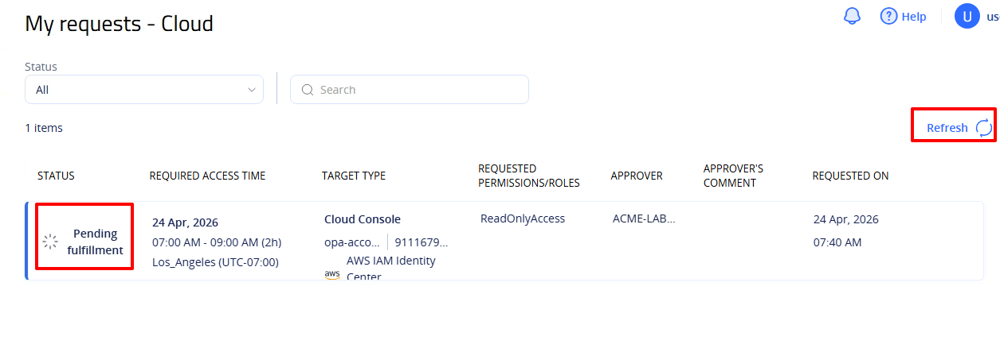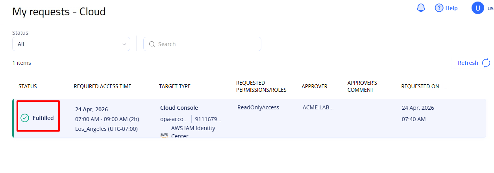

10) Once the status changes to **Fulfilled,** navigate to the **Apps and Secured Items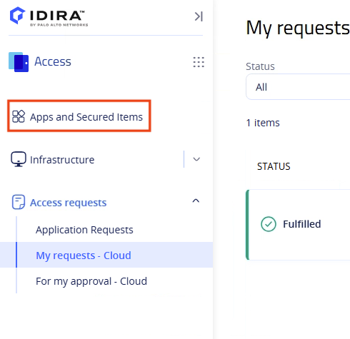**

11) Click on the **AWS IAM Identity Center** tile. 

12) Click **Continue**.

13) Notice that the account **opa-account-5Vi2PKn2YO-3** now appears in the Accounts list with the requested permission set. The access window is marked as limited, and the permissions will be automatically de-provisioned at the specified expiration date and time. There is **no** need to connect to the account.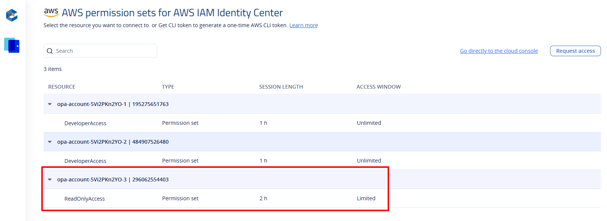

For additional details on requesting on-demand access to cloud services, please refer to the documentation [here](https://docs.cyberark.com/secure-access-space/latest/en/content/cloud-consoles/request-temporary-cloud-access.htm?tocpath=Access%20cloud%20consoles%7C_____4). For information on managing in-platform access requests, check [here](https://docs.cyberark.com/secure-access-space/latest/en/content/cloud-consoles/ar-in-app-requests.htm?tocpath=Manage%20on-demand%20in-platform%20access%20requests%7C_____0).

::: pagebreak :::
