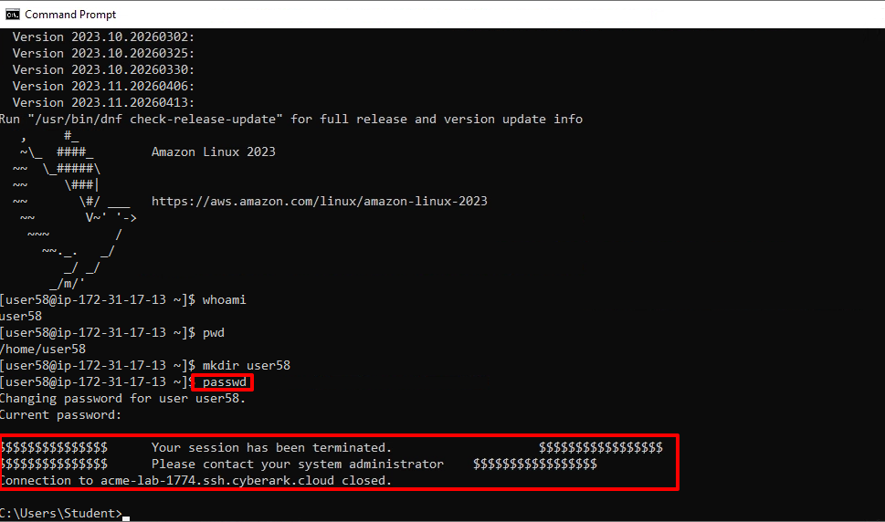
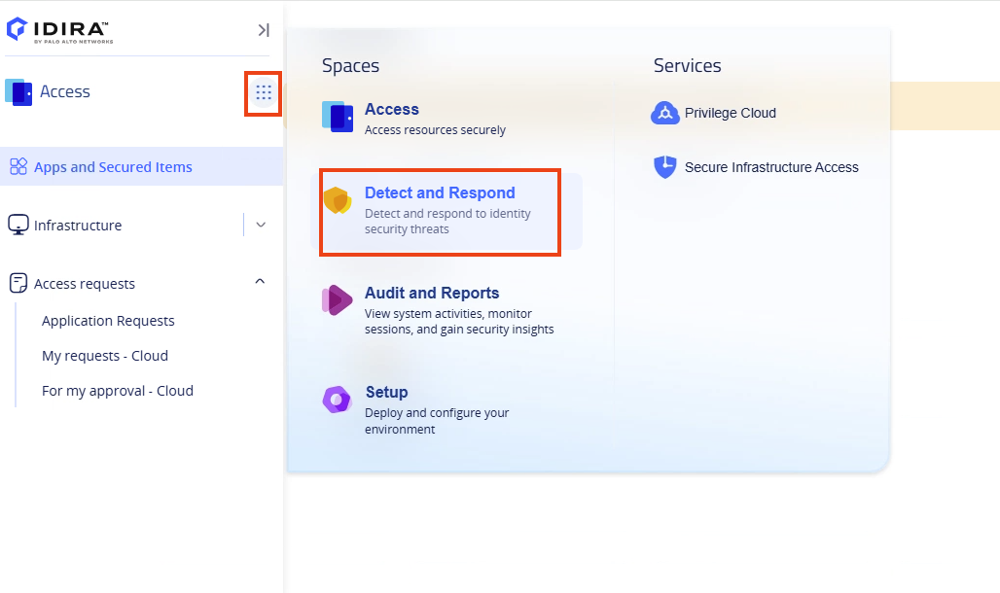
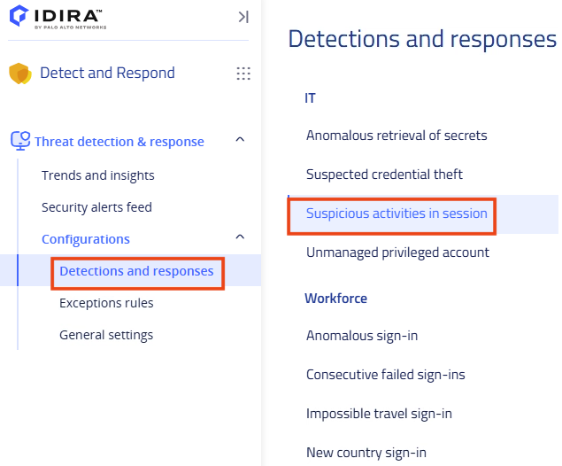
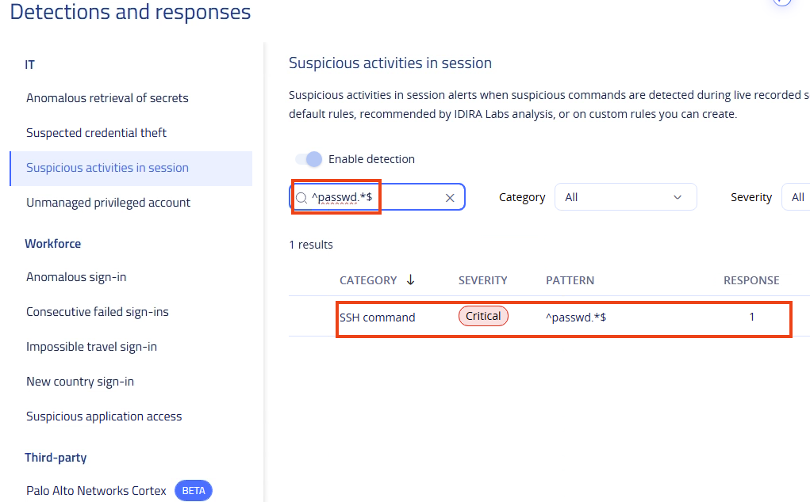
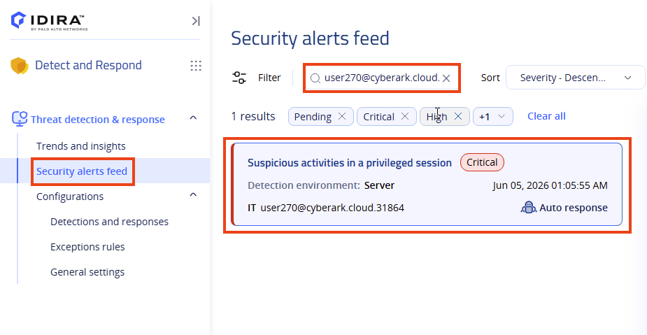
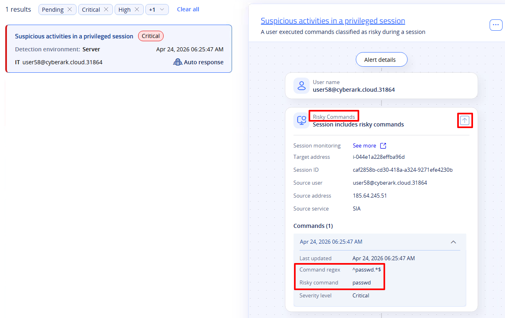
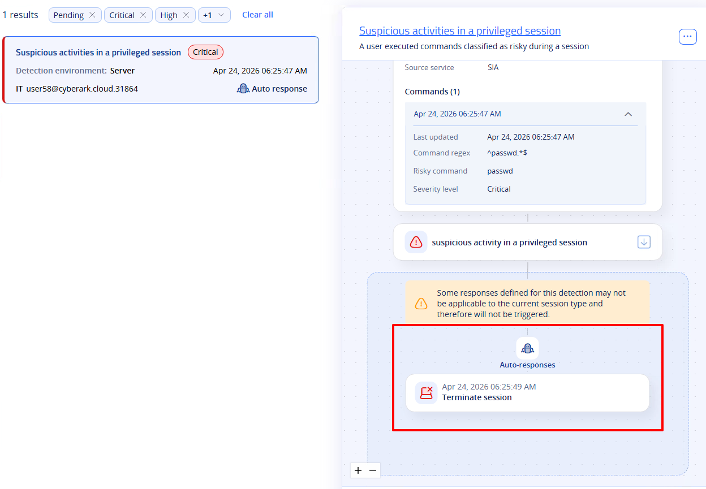
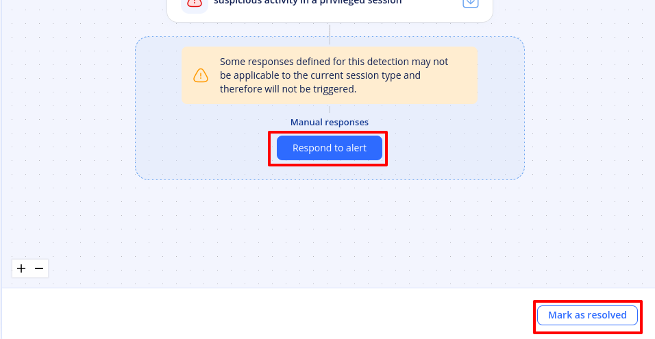
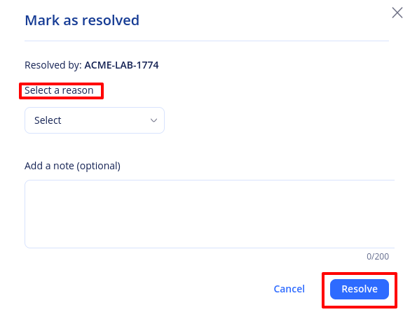

## Section 5: Threat Detection and Response

In this section, we will review the **S****uspicious Activities in Sessions** IT alert supported by Threat Detection and Response.

Threat Detection and Response enables organizations to automatically identify and address privileged security events. Continuous monitoring of identity systems helps detect suspicious activities and potential threats by analyzing logs, user behaviors, and system interactions for anomalies. Immediate actions, such as notifying security teams, isolating compromised accounts, and activating incident response protocols, are essential for containing and mitigating threats.

For additional details on IT alerts, please refer to the documentation [here](https://docs.cyberark.com/identity-protection-space/latest/en/content/itdr/alerts/privilege-alerts/configure-privilege-alerts.htm)

### 5-1 Suspicious Activities in Sessions

Suspicious activities in sessions rules enable you to detect suspicious commands during live and recorded sessions in your environment. In this section, the command in question is the **passwd** command, which was intentionally entered earlier in section 1.5 to be identified in this section.

1) Return to the **Access** space**,** click on the **Waffle** icon and navigate to the **Detect and Respond** space.

2) Under **Threat detection &amp; response** and **Configurations** select **Detections and responses.** Then click on **Suspicious activities in session** ****

3) Search for the <x-copy-text><strong>^passwd.*$</strong></x-copy-text> pattern. You'll notice that a specific pattern has been configured already for you to match any line that starts with the string *passwd* followed by any characters (or none) until the end of the line.

4) Navigate to the **Security alerts feed** and look for your user ^^%{metadata:CPC_Username}^^. You should observe at least one **S****uspicious activities in a privileged session** alert marked with critical severity.

5) On the right side, expand the **Risky Commands** section by clicking the downward-facing arrow. You will see that the risky command typed was *passwd*, along with the matched command regex.In this case, an automatic response was not configured, such as locking the user in Identity or implementing a custom response using Identity flows.

6) Notice in the bottom and automatic termination was set for this rule.

<x-block class="alert alert-warning">
For lab purposes, you were assigned the <strong>TDR Read-Only</strong> role. A user assigned a full permissions TDR role would have the ability to mark or resolve the alerts.
</x-block>

::: pagebreak :::
