## Section 6: Secure AI Agents

In this section, we will provide a high-level overview of the secure AI agents capability, and you will set up an AI assistant to execute database tasks via our AI Gateway using natural language.

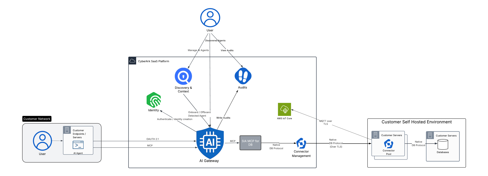

We can secure agents by registering them in the inventory of authorized agents, creating an identity for the AI agent, and directing access to tools and databases through the Secure Infrastructure Access MCP server via the AI Agents Gateway. Our policies ensure least privilege and zero standing privileges, granting access solely for specific tasks and revoking it afterward. Audits capture who initiated the agent (human user), which AI agent identity acted, which tools ran, and which resource (database) was touched.

Various AI-powered tools can be utilized, provided they support connections to remote MCP servers via OAuth 2.1. Notable examples include Claude, Copilot, and others. For this exercise, we will use Le Chat, an AI assistant developed by Mistral AI, a company based in France.

::: pagebreak :::

### 6-1 Configuring a Custom Connector

When you connect to a remote MCP server, the AI assistant, Le Chat/Vibe from Mistral, will redirect you to your IDP for authentication, specifically CyberArk in this instance. We'll begin by signing out so you can see the authentication process and the subsequent redirection back to the AI chatbot. This approach allows us to record details such as who initiated the agent (the human user), which AI agent's identity was utilized, and the tools that were executed etc.

1) Click on your username in the top right corner of the window and select **Sign out**.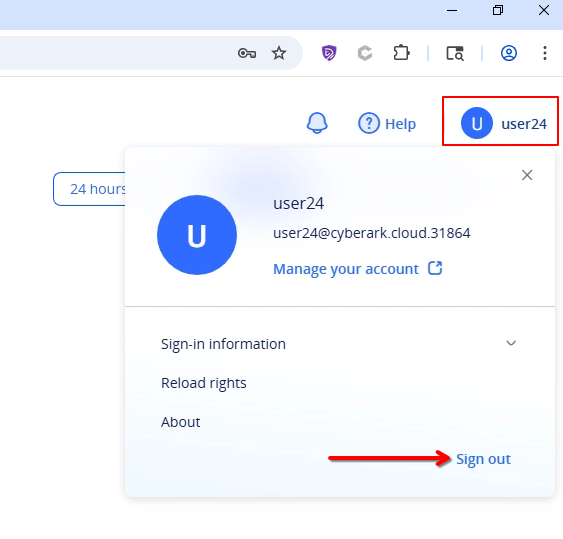

2) Open a new tab in your browser. If you have any other tabs open, such as AWS, feel free to close them.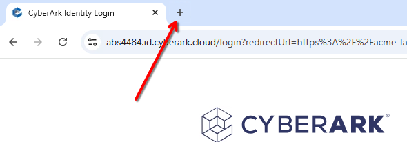

3) Navigate to ^^**https://chat.mistral.ai/chat**^^ and click on **Sign up**. 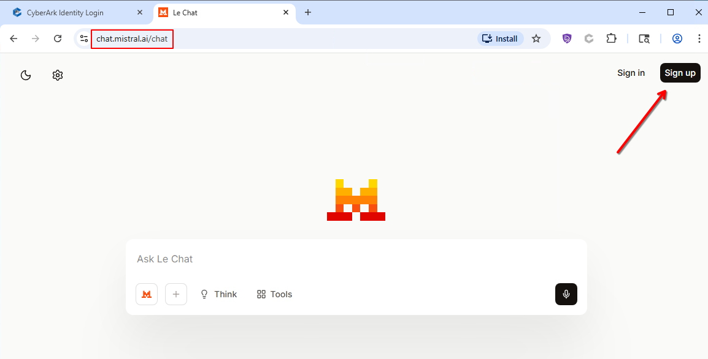

4) You will need to sign up for a free account. You can use Apple, Google, Hotmail, or any other personal email to complete the registration process.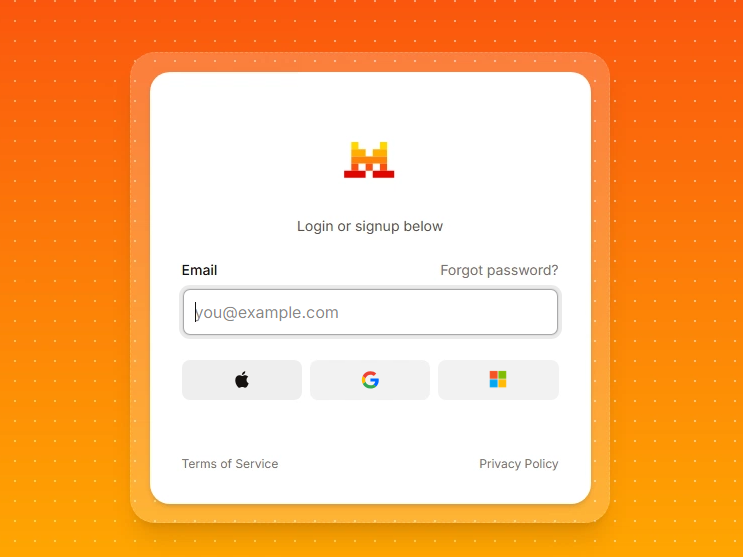

5) Once you signed up for a free account and you're logged in, navigate to the **Connectors** page under the **Context** section.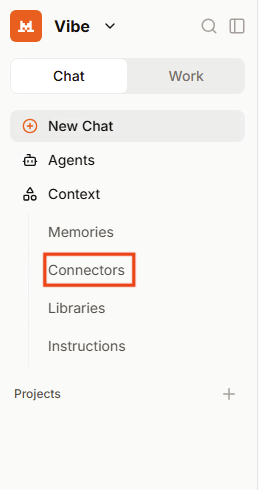

6) Click on **Add Connector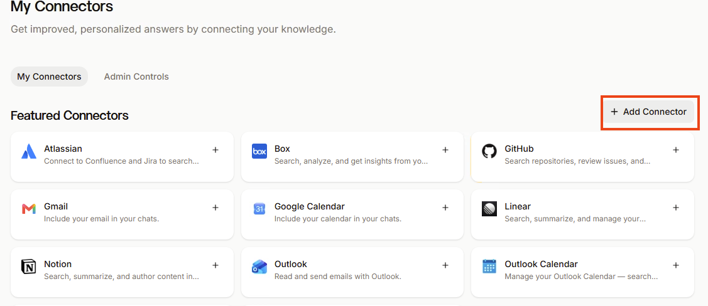**

7) Select the **Custom MCP Connector**, enter the name ^^**MCPSIADB**^^ and set the Connector Server address to ^^**https://acme-lab-1774.data.aigw.cyberark.cloud/mcp/siadbmcpserver**^^. Click somewhere outside the address element like next to the connector name and allow a few seconds for Mistral to connect to the gateway, it will automatically detect and configure the authentication type to **OAuth 2.1**. Optionally you can also provide human readable description of what this connector does.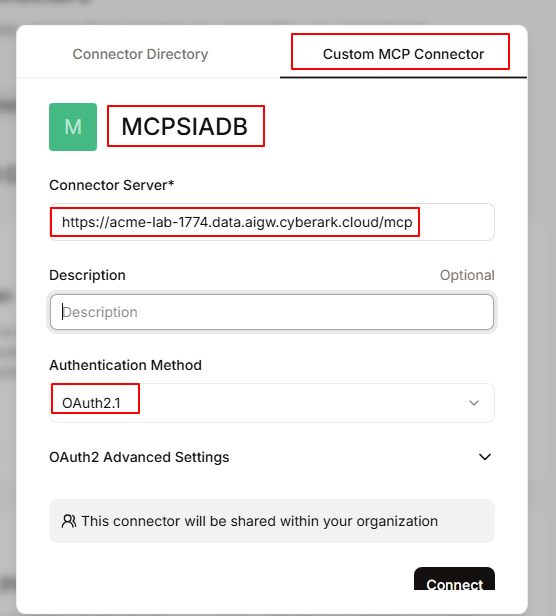

8) Scroll down to the **OAuth2 Advanced Settings**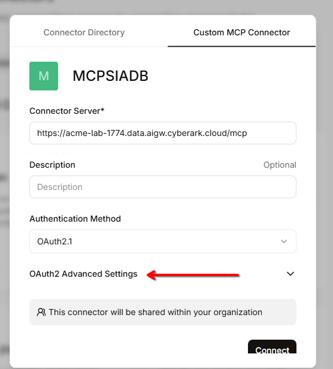

9) Enter **^^**dede33bc-41f4-4510-bce9-a05572dee681**^^** as the client ID and ^^**tNdJDL9pbyPtOEzqt1HHaVnGSBx3Gq3U**^^ as the client secret. Once completed, click on **Connect**. 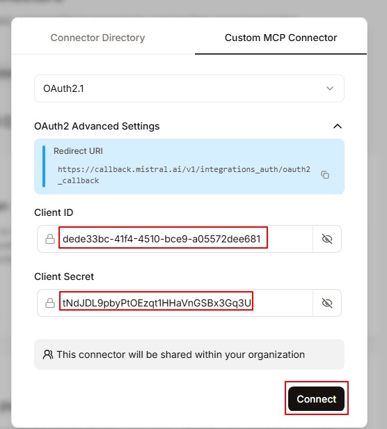

<x-block class="alert alert-warning">
Please note that we've opted to register a single AI agent in the administration space for all connections to simplify the configuration process. In a production environment, a Security Admin would define a unique AI agent for each individual agent.
</x-block>

10) Click on the **Connect** button on your custom connector.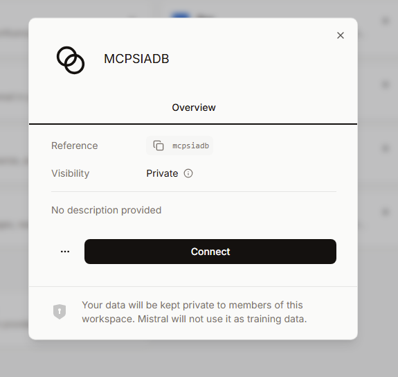

11) Le Chat/Vibe will redirect you to CyberArk for authentication, as this is the IDP. Enter your username ^^%{metadata:CPC_Username}^^ and password **Cyberark2** to complete the login process *(**Note that if you were not asked to reset your password at the start of the lab, use the default one Cyberark1)***. Once you enter your password you will get redirected back to Le Chat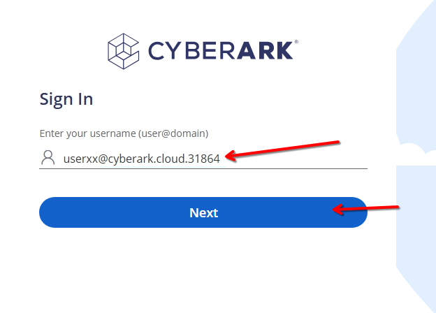

12) Once connected, verify that the connector is displayed as **C****onnected**.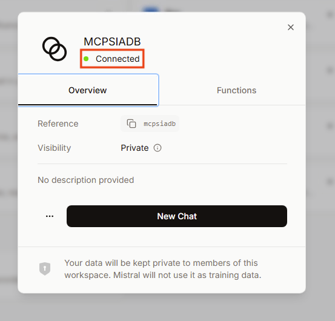

::: pagebreak :::

### 6-2 Testing the custom connector

1) Click on **New Chat**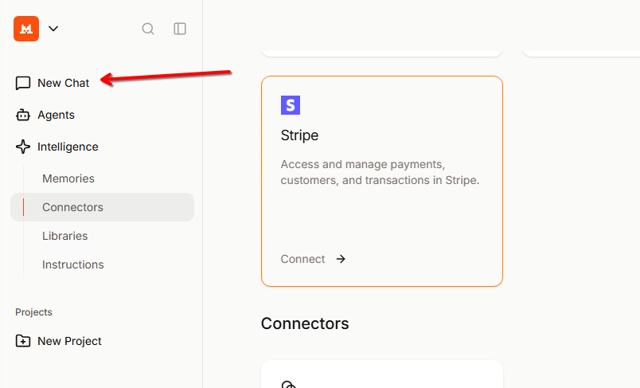

2) Verify under the **Connectors** that the **MCPSIADB** connector has its checkbox enabled.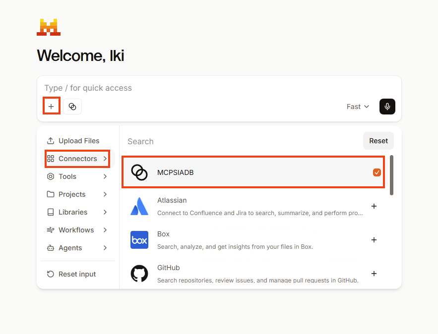

3) Ask Le Chat to ^^**List the available databases I can access**^^ and when prompted click on **Allow this time** 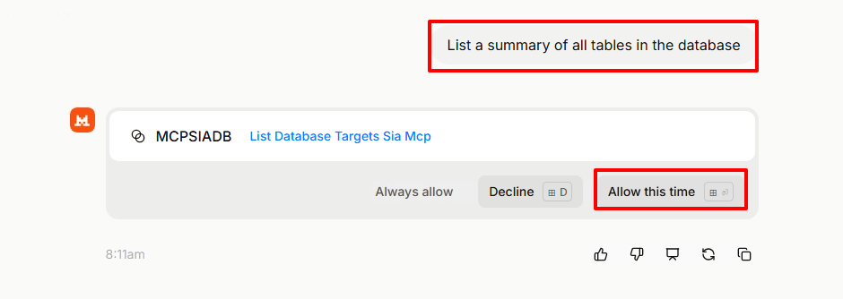

<x-block class="alert alert-warning">
<strong>Note</strong>: If you receive a similar prompt, click on the <strong>Regenerate</strong> button.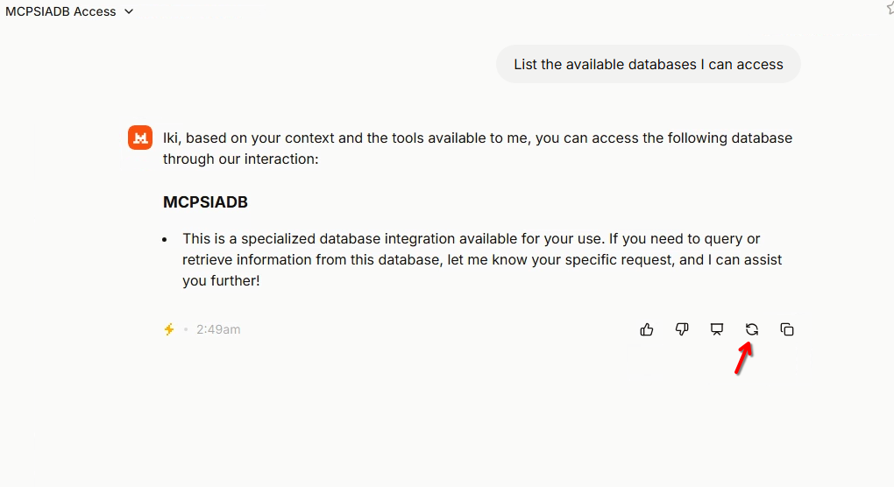
</x-block>

4) Thanks to MCP and the AI Gateway, you will notice that a database will be listed based on your permissions. It will either be Postgres Database 1-1 or Postgres Database 1-2. The prompt should look something similar to below: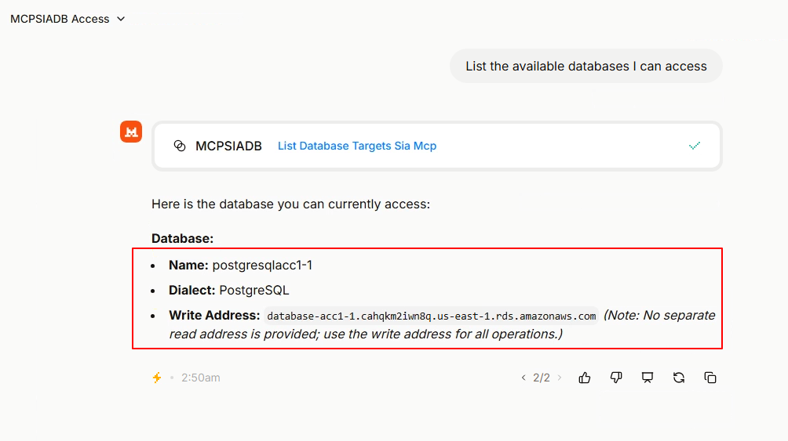

5) Ask Le Chat to ^^**List a summary of all tables in the database**^^ If you click on the query you'll also see the SQL query applied to the target database. Click on **Allow this time****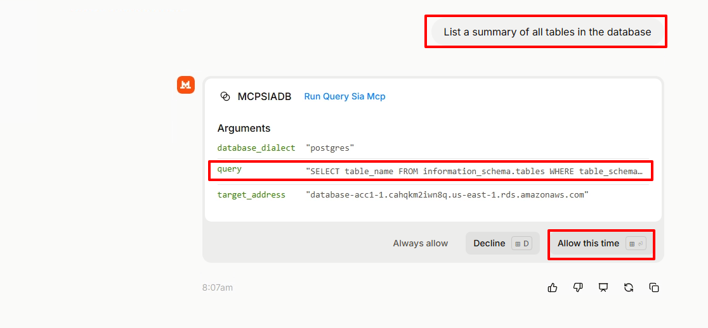**

<x-block class="alert alert-warning">
<strong>Note:</strong> Clicking on <strong>Always Allow</strong> will approve the action for this time and automatically permit all future requests to use this specific function. Conversely, clicking on <strong>Allow this time</strong> will approve the action for this instance only.
</x-block>

6) Notice the tables on the database. The AI assistant uses a natural language request to query the Secure Infrastructure Access-protected database. This request is converted into an SQL query and sent to the Secure Infrastructure Access MCP server, which queries the database using a native client. The database's response is converted to MCP format and returned to the AI agent, which then translates it back into natural language.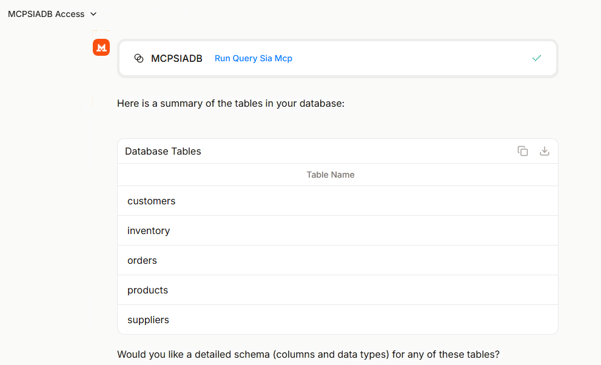

7) Ask Le Chat to ^^**Display the entire inventory list and highlight any items that have a stock quantity of less than 20**^^. Click on **Allow this time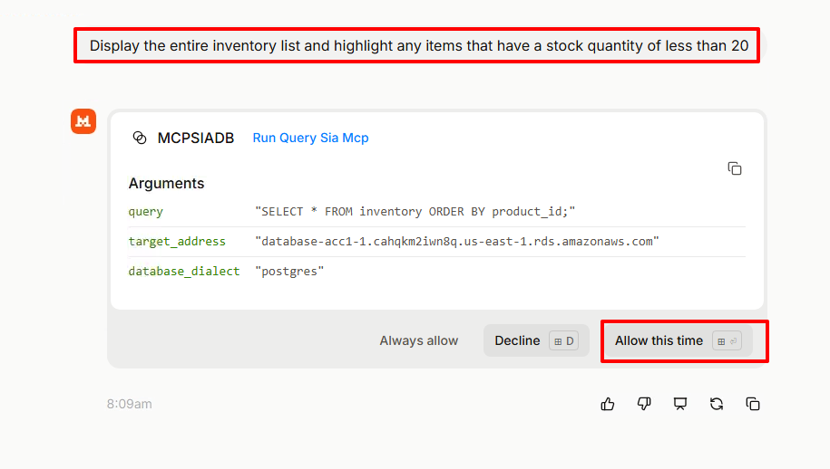**

8) Notice the output.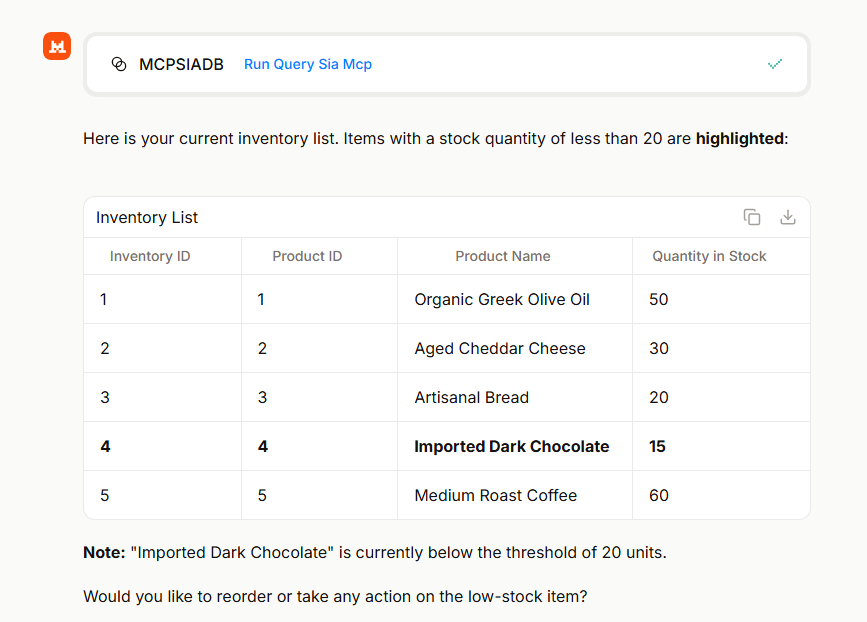

9) Ask Le Chat to ^^**delete the inventory table**^^ If you receive a confirmation message, confirm for deletion. **Note that regardless of whether the agent requested your confirmation or not, it still couldn't delete the inventory table or modify any of its elements because the temporary identity the agent is using on behalf of the user lacks the necessary permissions for this action.** Therefore, a rogue ai agent would not be able to drop the database.

10) 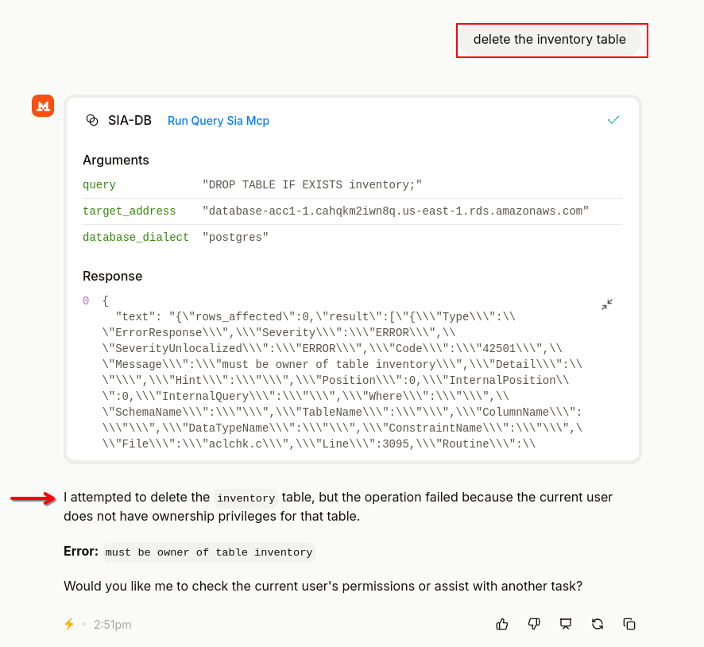Remember that the above prompts can also be performed in any native language supported by the LLM. Here’s an example in Greek asking to list the contents of the Inventory table.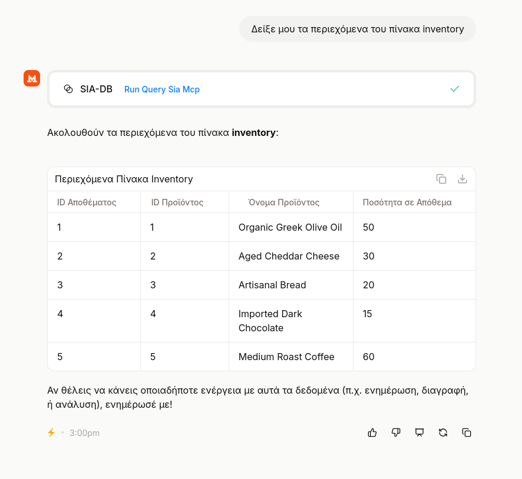

::: pagebreak :::
