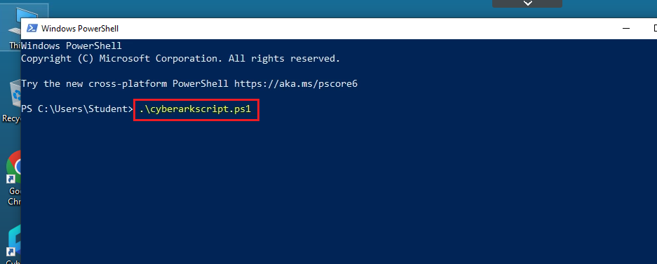
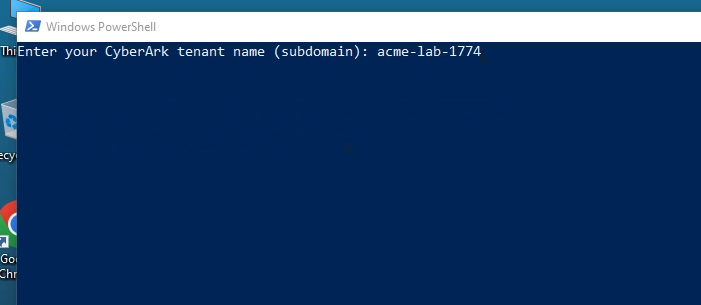
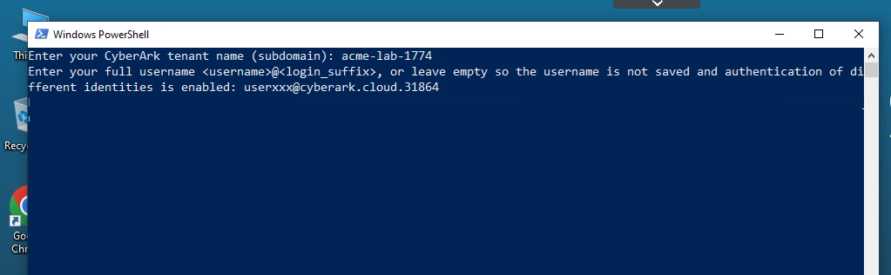
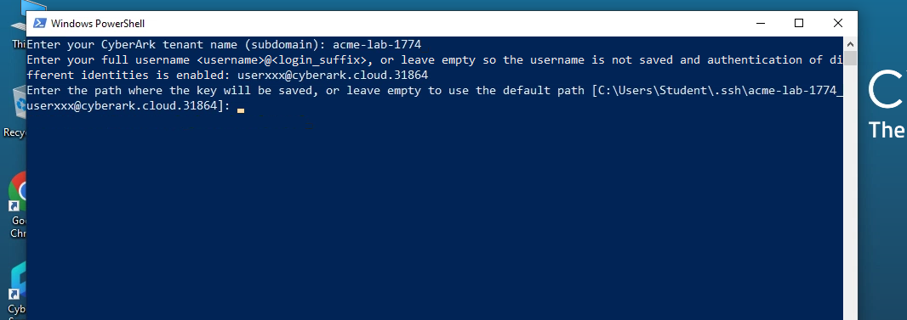
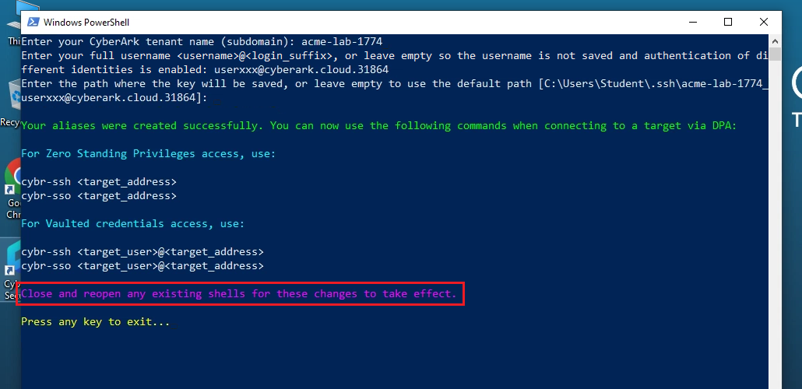
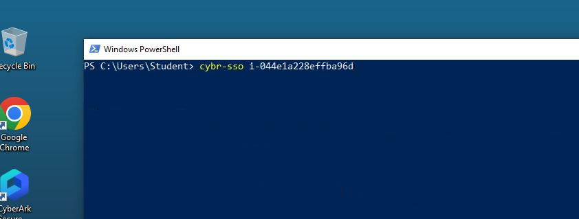
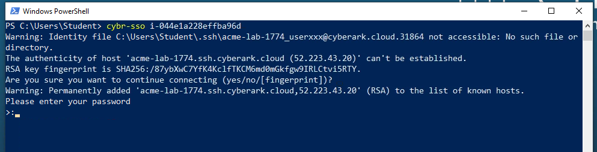
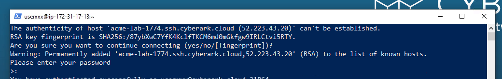
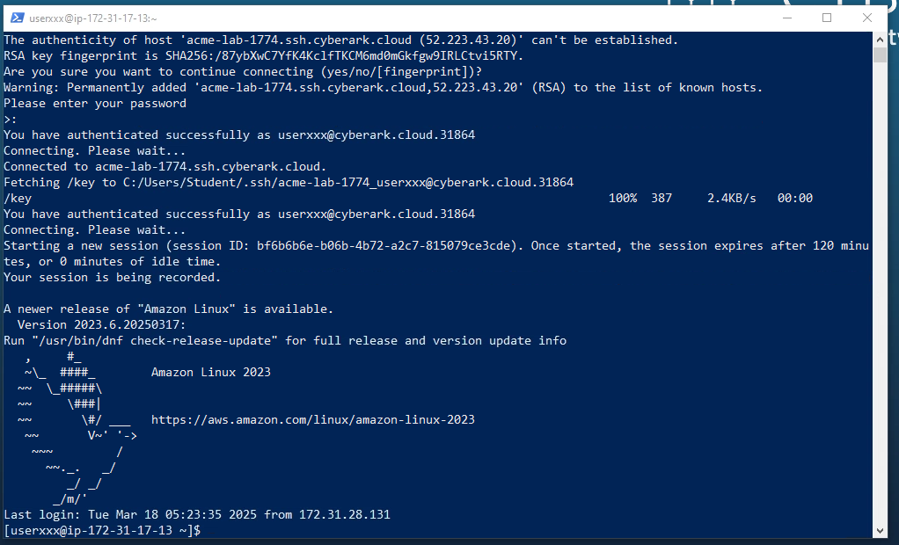
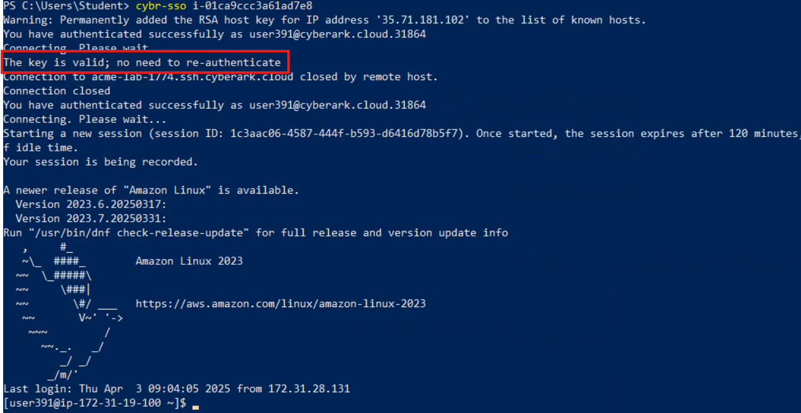

## Section 8: Optional Exercise

### 8-1 Create and run alias commands

Rather than copying the full SIA connection command from the **Access** space, we can simplify the process of creating reusable connection aliases for secure system access using CyberArk's [scripts](https://docs.cyberark.com/secure-access-space/latest/en/content/infrastructure/sas-linux-aliascommands.htm), without the need to connect to the web UI. The script will save the alias commands in your default shell environment. For this exercise, the Windows script has already been saved on your machine. Once you run the script for the first time, the following alias commands are ready to use :

- **cybr-ssh** Runs the SSH command for users who prefer not to use MFA caching or are unable to use it.
- **cybr-sso** Runs the SSH command using an MFA caching key.

1) Click the **PowerShell** shortcut on your taskbar.

2) Execute the script ^^.\cyberarkscript.ps1^^ 

3) Enter ^^acme-lab-1774^^ as your CyberArk tenant name 

4) Provide your user ID ^^%{metadata:CPC_Username}^^ when prompted for your full username.

5) Hit the **Enter** key when prompted for the path where the key will be saved. 

6) You will receive a summary of the alias creation and be prompted to close and reopen the window. Press the **Enter** key and **Close** the PowerShell window. 

7) Relaunch **PowerShell** from the taskbar.

8) Enter the **command** ^^cybr-sso &lt;instanceID&gt;^^ replacing *instanceID* with the AWS Linux VM instance ID from the previous exercise. 

9) If prompted for the RSA key fingerprint question enter **yes** and press **Enter**. ****

10) Enter **Cyberark2** as your **Password** and press **Enter**. *(Note that if you were not asked to reset your password at the start of the lab, use the default one Cyberark1)*

<x-block class="alert alert-warning">
When executing the alias command utilizing MFA caching, the script checks for a valid MFA key. If it's not present, it prompts for authentication. Upon successful authentication, the script retrieves the MFA key and establishes a connection, setting up a secure session with the target. Subsequent sessions will use this key, negating the need for re-authentication within the MFA caching period.
</x-block>

11) Verify you were able to connect to the target Linux VM.

12) Type ^^exit^^ to exit the SSH session.

13) Run the ^^cybr-sso &lt;instanceID&gt;^^ command again. Verify you can connect without having to type your password again.
